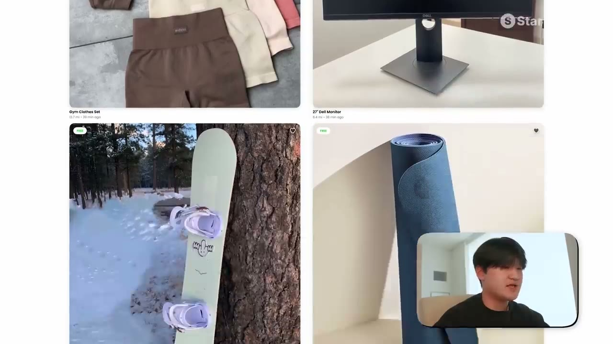
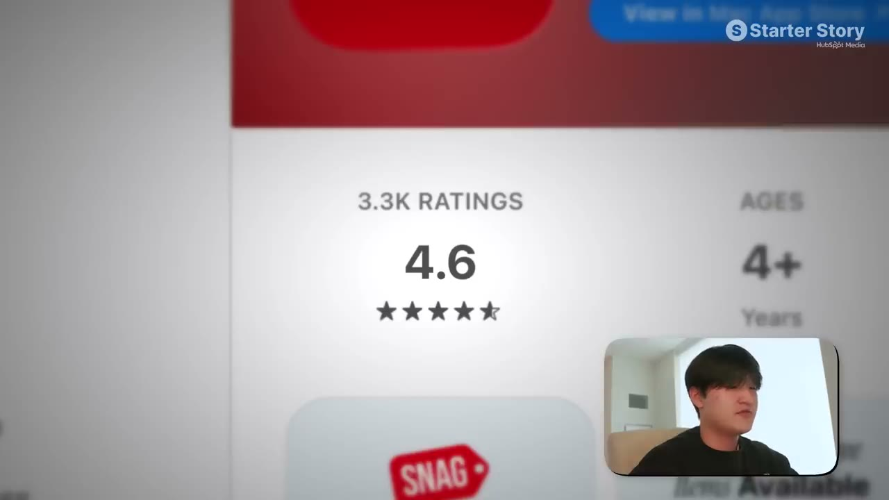
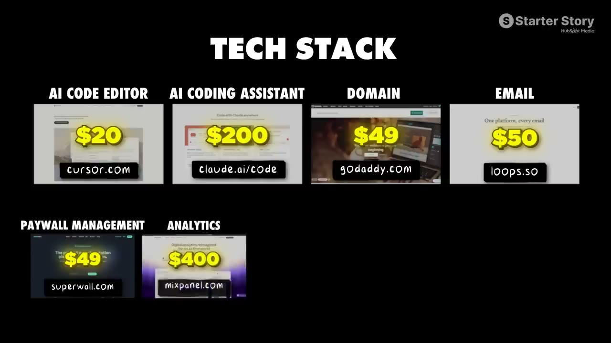
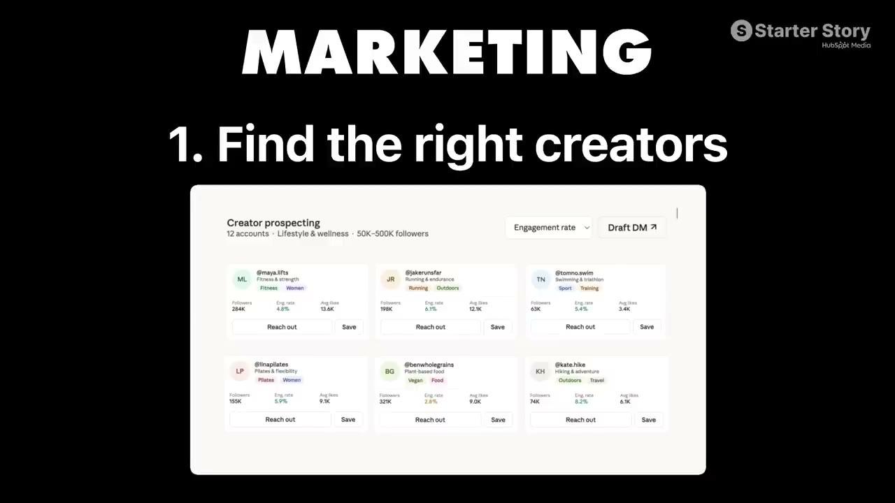
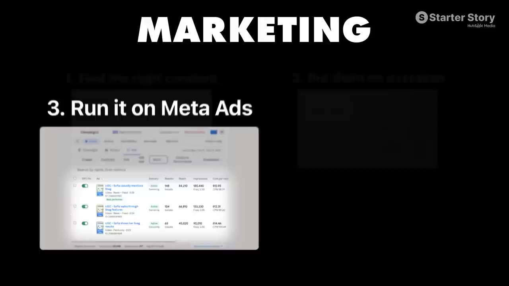
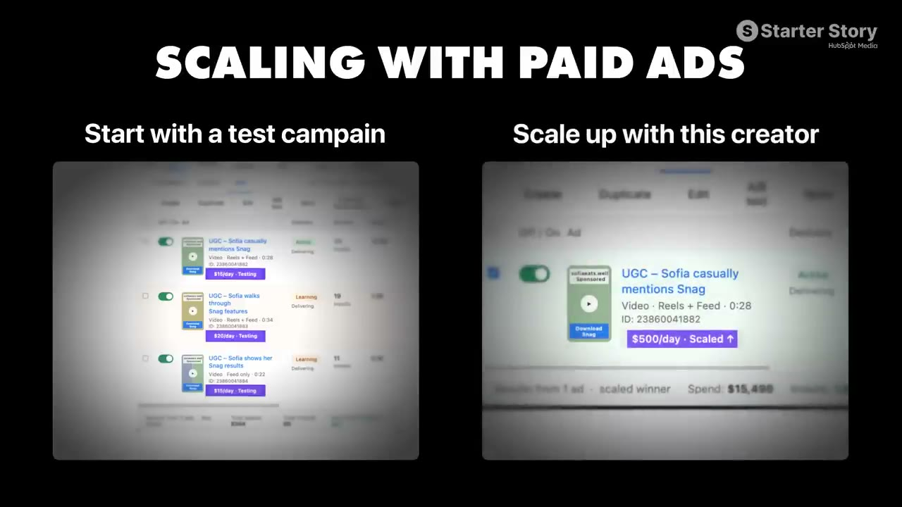

# 4 小时做一个 App，4 个月月收入 3 万美元，Benji 把流程讲了一遍

大家好，我是 Will-出海观察。

这期看的是 Starter Story 的一个访谈，14 分钟。嘉宾 Benji 一年做了 45 个以上的 App，最新这个叫 Snag，上线不到四个月，月收入到了 3 万美元。他说他每个 App 都走同一套流程，从想法到能收钱很快。

## Snag 是什么

Snag 帮人找附近的免费物品。首页是一排排物品图，可以搜索或筛选，喜欢的存进收藏。

订阅有周、月、年和一次性四种。他在 Superwall 后台给 Pat 看的数据是，月度经常性收入约 3 万美元，认证用户超过 10 万，累计收入 8 万美元以上。App Store 上有 3.3k 个评分，4.6 分。

他对转化率高的解释很直接。用户每月付几美元，换来的东西价值几百美元，没什么可犹豫的。

## 45 个 App 是怎么做出来的

他的第一个 App 叫 Pillar，自我提升类，靠几乎零成本的获客做到 1.1 万用户，然后他停了，原因他自己说是“shiny object syndrome”，看到新东西就想做。第二个是 HeightGPT，同样没守住，接着一口气做了后面 43 个，之后才决定只盯一个产品。这 45 个里有多少赚到了钱，视频里没提。

流程他讲得很具体。

1. 先从营销倒推。想清楚要在 App 里展示什么价值，再想怎样让用户在三秒内被吸引。
2. 去 Figma 画线框、做设计。
3. 把设计稿交给 Claude Code，在 Cursor 里把代码写出来。
4. 整个过程 4 到 5 小时，不含后端。后端放在 Supabase。

画面上标的价格是 Cursor 20 美元、Claude Code 200 美元、GoDaddy 域名 49 美元、Loops 邮件 50 美元、Superwall 付费墙 49 美元、Mixpanel 数据分析 400 美元，视频里没说计费周期。另外还有苹果开发者账号和 Figma 订阅。几样工具的分工他也讲了。Superwall 用来 AB 测付费墙，Mixpanel 看新手引导做得够不够好，Loops 给流失的用户发邮件，把人拉回来。

## 点子从哪找

他看 YouTube 和 Twitter，看别人靠什么赚钱。也去 Sensor Tower 搜赚钱的 App，照着做一个，再做好 10%。

HeightGPT 就是个例子。它上线之后冒出来大约 20 个模仿的 App，据他说也在赚几十万美元，原因是界面更好，营销更好，漏斗也更好。点子本身值不了多少钱，能把产品比别人更好地交到用户手里才值钱。

## 增长靠 UGC，再把素材变成广告

这一段占了视频最多的时间，也是他认为最重要的部分。

做法是这样的。

- 先批量联系创作者，一个个面试，看他有没有做出爆款的潜力。通过率大约 10%，面试 100 个，能留下 9 到 10 个。
- 留下的人按月度保底加 CPM 付费，先测试。
- 单条视频超过 5 万播放，就拿去投 Meta 广告。

他给了一个参照。一条 24 万播放的视频，每 10 万播放大约带来 1000 到 2000 美元的订阅利润。

投广告先开测试，每天 50 美元，看这条素材值不值得继续。ROAS 大于 1，或者点击率很高，就往上加，第二天 100，再 200，300。有一条素材他一共花了约 3000 美元，到那时 ROAS 转负。他说 Meta 广告的增长不是线性的，花得越多边际回报越低，素材也会疲劳，所以要不停做新素材，“拿更多彩票”。

主持人 Pat 补了一句我觉得很实在，长期跟 UGC 创作者合作很麻烦，要不停招人，有人会流失，素材跑通以后转去投广告，这部分头疼就少了。

## 如果让他从零开始

他给了四步，说这套他第一个 App 就用过，当时他还是个没什么钱的大学生。

1. 找一个能做大、也做得出来的点子。好产品用户转化高，也不想退订，这一步杠杆最大。
2. 开始做。刚起步多半是单一功能、调用一个 API 的 App，也可以，只要功能正常，并且有账号登录，这样才能过 App Store 审核。
3. 分发。没钱请创作者就自己拍，他自己拍过上千条。找剪辑批量剪，再拿去投广告。
4. 迭代产品，把 LTV 做高，把 CAC 压低。

视频中间和结尾，Starter Story 都在推自己的 iOS 训练营，这部分当广告看就行。

看到这了，点点关注👇
