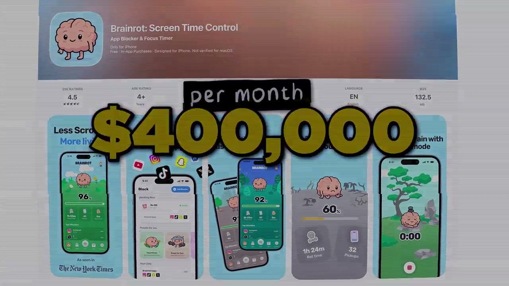
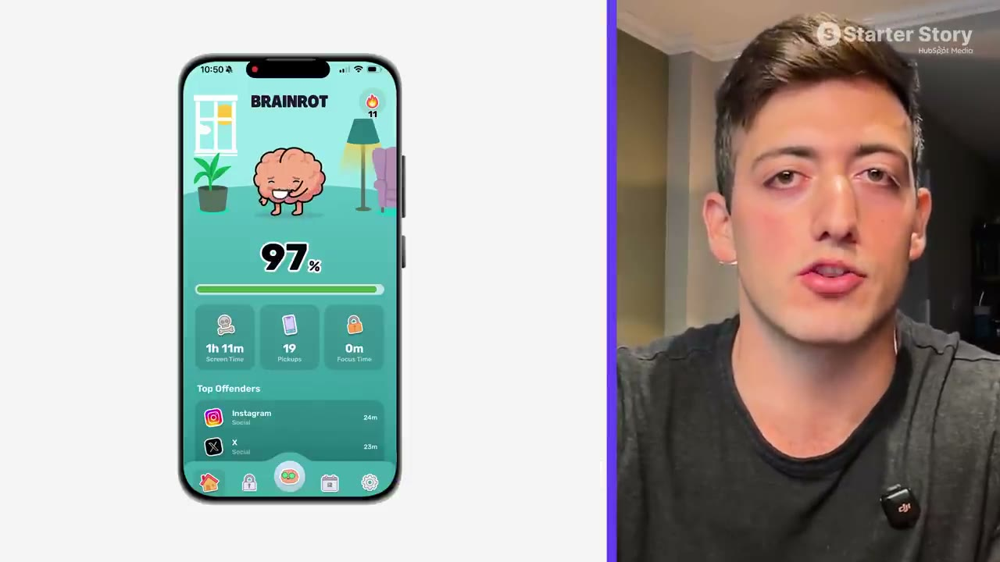
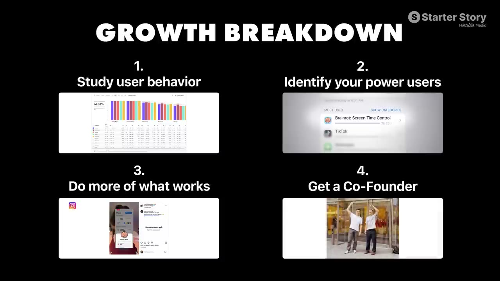
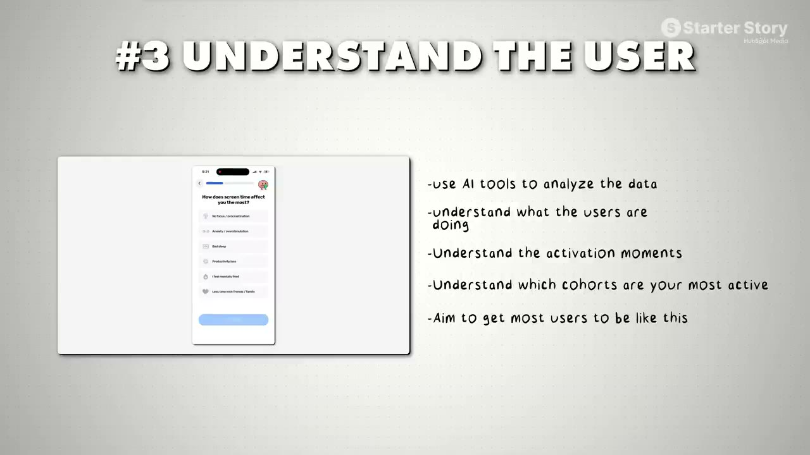
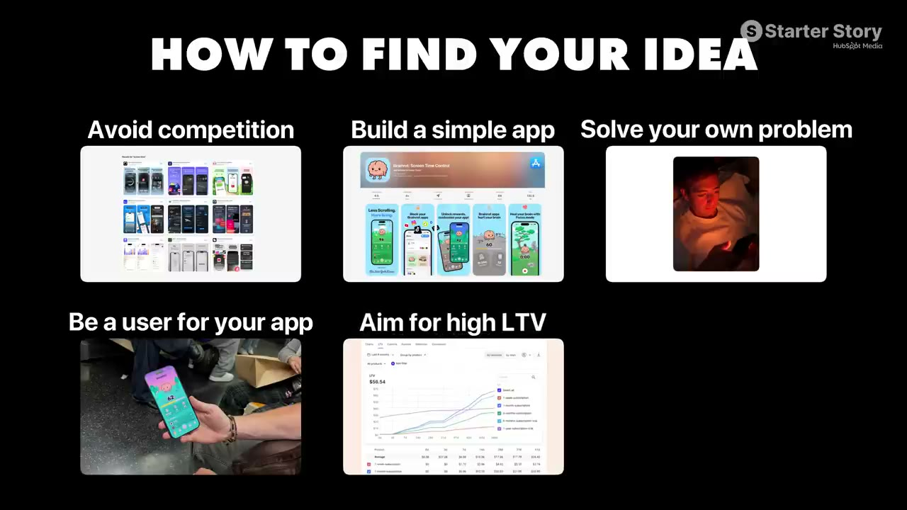
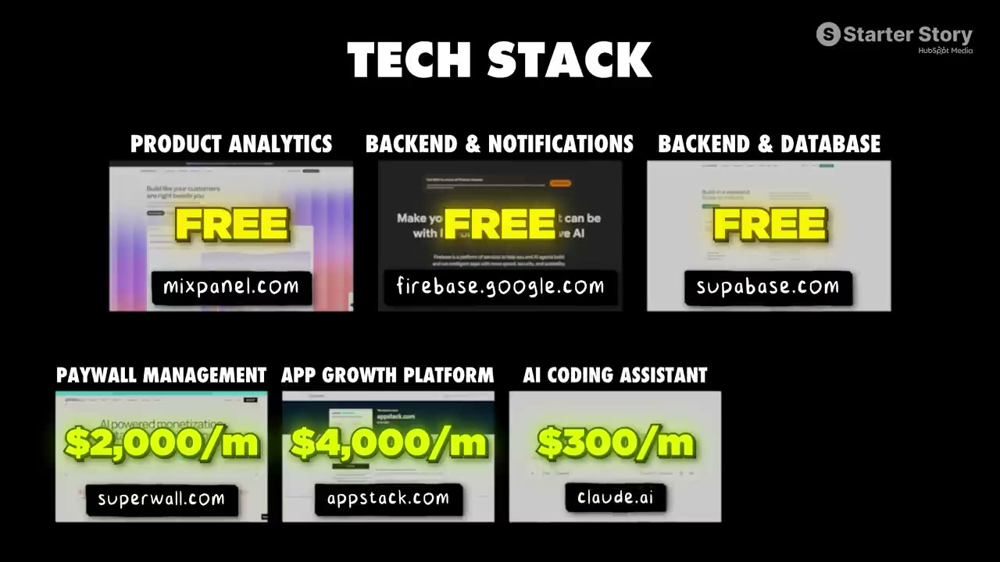

# 给自己做了个戒手机的 App，一年从月入 1 万美元做到 40 万

大家好，我是 Will-出海观察。

这期看的是 Starter Story 的一个访谈，12 分钟。嘉宾 Yoni Smoliar 原来是公司里的软件工程师，去年夏天上线了一个叫 BrainRot 的 App，据他说月收入从约 1 万美元涨到了 40 万美元。他的起点有点特殊，上线前手里已经有 10 万到 15 万 Instagram 粉丝。

## 给自己做的戒手机 App

Yoni 以前在公司写软件，一直想做点小生意，试过几次都没起来。那阵子他泡在独立开发者的圈子里，追着 Pat Walls、Pieter Levels 这几个人看，这些人每次推出新产品，上线第一天就有用户，因为他们自带受众。他也想这样，就开始拍内容，把创业的幕后过程讲出来，看会发生什么。

App 的点子来自他自己。他刷 Instagram、YouTube、Twitter 停不下来，屏蔽 App 的软件早就有，他也知道自己不是第一个想到这个方向的人。他想到的是另一个设定，一只宠物大脑，你刷得越多，它烂得越厉害。他当时觉得还没人做过，自己是个天才，兴奋到放下手头所有事，埋头做了一个月。

BrainRot 是个带游戏味的屏幕时间 App，名字来自 brain rot，网上形容刷短内容刷到脑子发钝的说法。收费是订阅制，以年订阅为主。他说下载有几百万次，画面上 Sensor Tower 的数据是过去一年全球下载 1000 万，主要国家是美国、德国、英国。

演示里，首页是那只宠物大脑，健康度 97%，下面是今天的屏幕时间和最耗时的 App。可以按时间段给不同 App 设屏蔽规则，也能看每天各个 App 的用量统计。核心功能出现在想打开被屏蔽的 App 的时候。他点开 Instagram，弹出一段小流程，这次是大脑给他打来 FaceTime，他得先应付完这一段才能进去。他说这点摩擦不大，却够让人改掉习惯。

## 从月入 1 万到 40 万

上线前他一直在帖子里卖关子，说自己在做 App，邀请大家登记候补名单。上线首日，据他说大约做了 1 万美元。

从这里涨到 40 万，他讲了三件事。

1. 弄清用户怎么用 App。上线以后有了真实数据，就能分出核心用户和普通用户，核心用户要吃透，所以得去看分析数据。他说这一步对他们帮助很大。
2. 对自己有效的事加倍。他的说法是，某件事有效，就试着多做十倍。他们早期增长靠的是网红内容和付费广告，所以就一直放大这两样。
3. 一个人做的话，认真考虑找合伙人。他和 Brock Anderson 合伙以后，他形容对生意的作用是 force multiplier（力量倍增器）。

主持人 Gus 还问他什么时候全职做这个。他没给日期，也没给数字，只讲了想法。他想过很久，一直在等跳出去风险变小的那一刻，后来想通了，哪条路都有风险。留在不开心的工作里有风险，让想做的事慢慢淡掉也有风险，最后看自己能忍多大程度的不舒服。他也补了一句现实的，手里得有够撑一段时间的钱，真不行还可以再找份工作，没有那么严重。

## 重来一次，他会这样做

Gus 问，如果 2026 年重新做 App，他会怎么做。他给了六条。

1. 找一个自己真的兴奋的问题。他的标准是，它得是早上第一件想做、晚上最后一件想做的事。做到难处，不够兴奋的人会放弃，难处又一定会来。
2. 找人一起做。一个人要做的事太多，可以找技能互补的合伙人，也可以拿股权换团队。他补了一句，这些股权现在还一文不值。
3. 弄清用户在 App 里做什么。把埋点数据发给 Mixpanel 或 PostHog 这类分析服务，再让 Claude 或 Codex 去分析。要找到激活时刻（activation moment），也就是用户第一次尝到产品好处的那个时刻，再找出最活跃、最上瘾的那批人，想办法让其他用户也做出同样的行为。
4. 不停做小实验。比如把新手引导里的一页挪到别处，或者改变用户先看到什么。他说十次里有九次动不了数字，有一次能改变走势。
5. 分发上，不同受众的价值不同。要弄清哪个渠道买到的用户更便宜，这些用户又各自带来多少收入。
6. 结果有滞后。输入和结果之间常隔着很长的时间，连着几周、几个月做对的事，会在之后才收到成果，这时人容易松懈。他的提醒是，今天做的事，决定以后的结果。

## 点子怎么找

Gus 问，对没有头绪的新手，怎么找点子。他的回答分五条。

1. 第一次出手，别进竞争激烈的领域。
2. 做简单的工具。一个核心功能，解决一个核心用户的一个核心问题，别做功能很多的超级 App。
3. 做自己了解的东西，或者替自己解决问题。别追热点，也别抄别人的 App 赚快钱。
4. 自己每天用，对自己老实。
5. 做高 LTV（一个用户一生带来的收入）的东西，或者用户每天都会打开的东西。

他最后补了一句，这话不新鲜，最好的建议还是做出对用户有价值的东西。

## 工具栈和月费

他列了这些工具。价格是画面上标的，口述里没提，视频里也没解释怎么计费。

- Mixpanel 做数据分析，画面标的免费。
- Firebase 做分析和实验，画面标的免费。
- Supabase 做内部工具和追踪，画面标的免费。
- Superwall 做付费墙，画面标的每月 2000 美元。
- AppStack 做付费广告归因，画面标的每月 4000 美元。
- Claude Code 和 Codex 写代码、处理公司内部杂事，画面标的是 claude.ai 每月 300 美元。
- Upwork 找外包和自由职业者，没标价。

三项付费工具加起来每月 6300 美元，约占他说的月收入的 1.6%。

## 我的几点看法

上线以后那一段最能拿来用。他自己也说起点不寻常，上线前有 10 万到 15 万粉丝，首日约 1 万美元，多数人的第一天不会是这样。上线以后的几步，看数据、找核心用户、把有效的渠道放大，不靠粉丝也能做。

可以直接套用的是实验的比例。他说十个小实验里有九个动不了数字，有一个会改变走势。排计划时按这个比例想，一个改动没效果很正常，先别急着否定整个方向。

保留的是数字的口径。视频里的 40 万是收入，没提利润，也没提广告和网红花了多少，而这两样正是他说的早期增长来源。三项付费工具占不到 2%，大头花在哪里，视频里没讲。他口述的下载量和 Sensor Tower 的数据也差得不小，看这些数字时留点余地。

视频中间 Starter Story 推了一份 100 多个、启动成本 500 美元以下的创业点子库，那一段当广告看就行。

看到这了，点点关注👇
