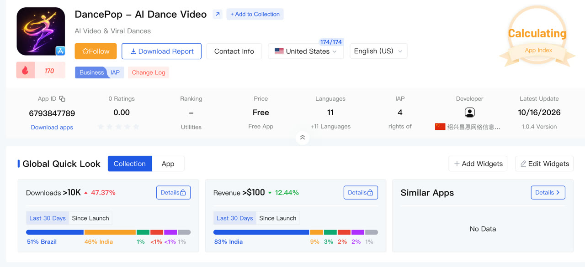
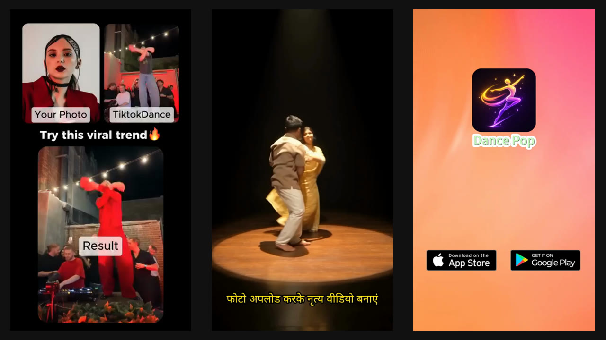
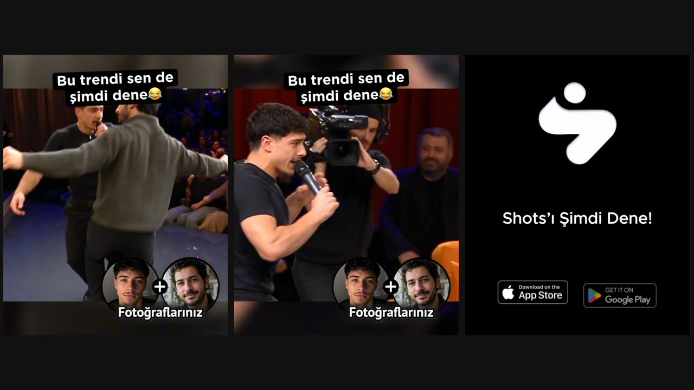
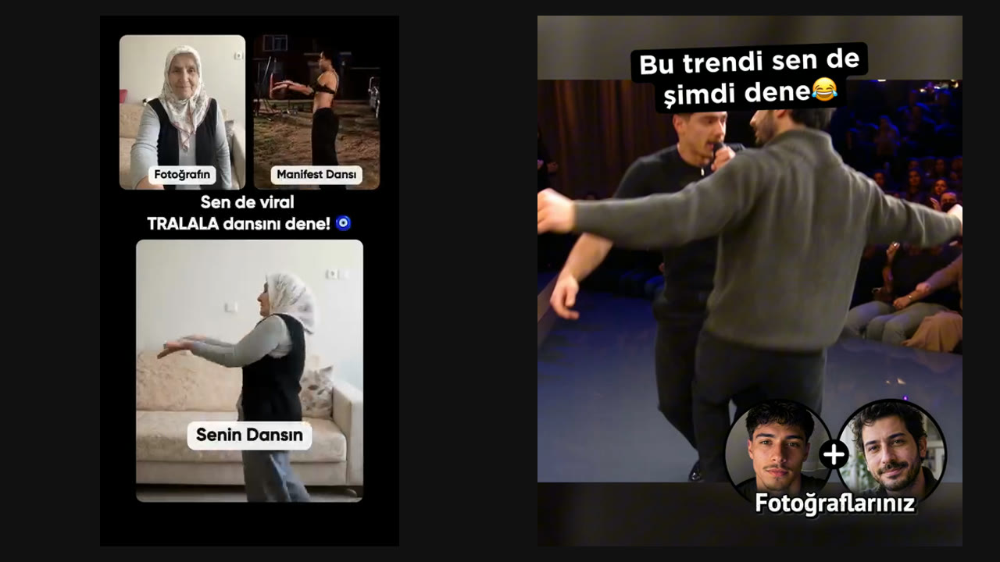
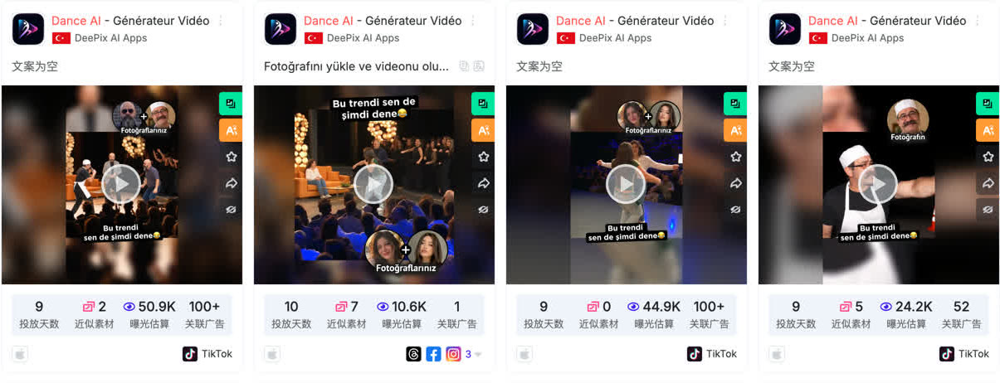
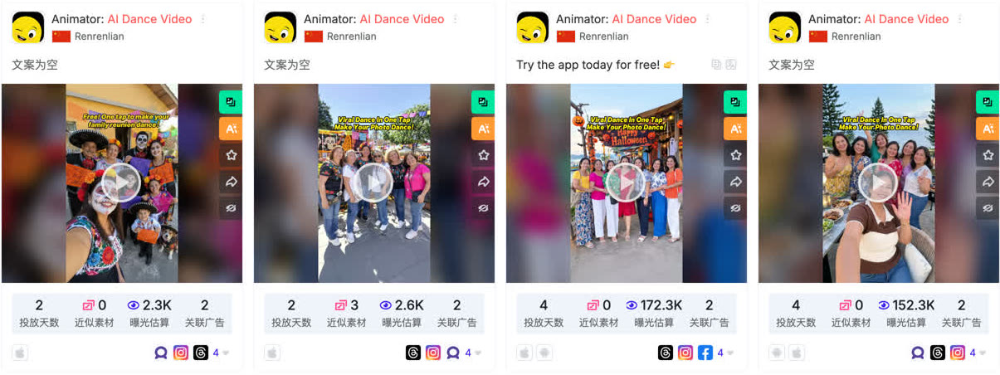

# DancePop 投了 3235 条广告，30 天下载 1 万+、收入 100 美元+，我把它和 Dance AI 的素材拆了一遍

大家好，我是 Will-出海观察。

这期看的是 AppGrowing 上两个 AI 跳舞视频 App 的广告素材。DancePop 有 34 条视频，Dance AI 有 33 条，另外还有两页搜索结果截图，以及点点数据上 DancePop 的商店页。DancePop 在 AppGrowing 里被记了 3235 条广告，点点上近 30 天下载标的是 1 万以上，收入标的是 100 美元以上。Dance AI 的素材几乎全是土耳其语，同一段电视舞台换脸，出了一整批。

## 两个 App 是什么

功能一句话能说完，传一张照片，生成一条自己在跳舞的视频。两家的广告也都在演这个过程，画面角落放一个圆形头像，旁边一个加号，其余地方是跳舞的结果。

DancePop 是免费 App，点点上显示开发者是绍兴的一家公司，评分数 0，支持 11 种语言，有 4 个内购项目，最近一次更新是 10 月 16 日的 1.0.4 版。近 30 天的下载量标的是 1 万以上，其中巴西占 51%，印度占 46%，两国合起来 97%。收入标的是 100 美元以上，印度占 83%。这两个数都是点点给的区间下限，具体多少看不出来。

广告也集中在这两个国家。AppGrowing 里印度有 340 条素材、1435 条广告，巴西有 245 条素材、739 条广告，这两个国家同时有 AdMob、Meta 和 YouTube 三类广告。美国只有 20 条素材、51 条广告。广告数据里一共出现 136 个国家，其中约 90 个国家显示的是一模一样的组合，AdMob 6 条、YouTube 4 条，更像平台给的最小展示值，所以 136 这个数字别太当真。广告铺了那么多国家，下载只出现在广告最密的两个。

Dance AI 的开发者叫 DeePix AI Apps，卡片上挂着土耳其国旗。App 名字有法语、德语、西班牙语几个版本，素材却几乎全是土耳其语。截图里看不到投放地区，我猜是冲着这几个国家的土耳其裔用户，只是猜测。它的下载量和收入我没有数据。

## DancePop 的素材是怎么拍的

AppGrowing 近 30 天在 Meta 系返回了 174 条 DancePop 的素材，读取了其中 100 条，全是竖屏视频，一张图片都没有。约 52 条用的是同一句文案，Turn 1 Photo into a Realistic Dancing Video with AI。约 21 条写的是 Turn your cat, dog, or bunny into a dance superstar，约 9 条写的是 Always dreamed of looking like a dancer in a music video。我手里的 34 条视频也全是 9 比 16 的竖屏，长度中位数 16.6 秒，最短 9.4 秒，最长 33.2 秒。

用得最多的是三屏对比，结构是这样的。

1. 上方左边是用户的照片，右边是 TikTok 上的参考舞蹈。
2. 中间一行字写舞蹈名，我看到过 JAWN Dance、Footloose Dance、League of Legends dance、Firestarter Dance，也有不指名的 Try this viral trend。
3. 下方是生成的结果，Result 两个字压在画面上。
4. 结尾一张 2 到 3 秒的品牌卡，放图标和 App Store、Google Play 两个按钮。

AppGrowing 读了 30 条素材的画面，约 14 条是这种分屏，约 12 条一开场先放成品，约 18 条结尾有品牌卡。JAWN Dance 那条下面记着 46 条近似素材，是这页 DancePop 卡片里数字最高的一条。

其他几种拍法在我手里的素材里都有。单人大画面加角落的 Your Photo 头像，主角是穿绿 T 恤的中年男人、客厅里穿灰 T 恤的女人。2 到 4 秒的产品界面，一个 Upload your photo 页面，下面一个绿色的 Generate 按钮。宠物，一只猫或一条柴犬站在几个舞者中间，配字是 This is what a single selfie of your pet turns into。印度的素材单独成一类，字幕是印地语，一对穿纱丽的男女站在聚光灯下跳双人舞，我数到至少四条。AppGrowing 的分析里，印度是唯一明显做了本地场景的市场，其余地区用的是通用素材。

主角和受众之间有个错位。AppGrowing 估算的投放受众里，男性占 74.74%，25 到 34 岁占 43.77%，素材里的主角却多是女性、小孩和宠物。同一个脚本换成男性主角跑一轮，就能看出差别大不大。受众比例是估算值，主角错位有没有拖低转化，素材本身看不出来。

## Dance AI 的素材从哪来

Dance AI 这边的 33 条视频，20 条是 9 比 16，13 条是 4 比 5，DancePop 的 34 条里一条 4 比 5 也没有。长度中位数 25.7 秒，比 DancePop 的 16.6 秒长了 9 秒多。

我看到的几个母版都是现成的电视和街头视频，换了脸。按长度和镜头切点分，33 条只有五六个母版。25.7 到 25.8 秒的一个母版占了 13 条，切点一模一样，只是换了人脸，再导成 9 比 16、4 比 5 和低清几种规格。其余的母版是 19.3 秒、20.8 秒、22.0 秒和 34 秒的。

占了 13 条的母版拍的是一档电视节目的舞台。台上两个人在跳，旁边有橙色沙发，一个人扛着摄像机，一个人举着话筒，台下是观众席。屏幕下方是同一句土耳其语，Bu trendi sen de şimdi dene，大意是你也来试试这个潮流。角落的头像一次放一到三张，我数到至少五组不同的脸。除了两个年轻男人和两个年轻女人，还有两位老人，另有一组是光头墨镜男人配白帽厨师。

其余的母版有三种。一张电视圆桌，三个人围着桌子争论。一间新闻演播室，主播坐在桌后，字幕换成 Bu viral sahnede sen de yer al!，意思是在这个爆款场景里也给你留个位子。还有一段街头墙边的短视频，上半屏标着 Orijinal，下半屏标着 AI Video，上面是原片，下面是换了脸的版本。片源是谁的，有没有授权，素材里看不出来，AppGrowing 上也没有标。

结尾卡写的是 Shots'ı Şimdi Dene!，意思是现在就试试 Shots，图标也是 Shots 的，下面是 App Store 按钮，有的还带 Google Play。这批素材挂在 Dance AI 名下，结尾推的却是 Shots，同一页里还有一张卡片直接挂在 Shots Photo & Video 名下，开发者同样是 DeePix。我分不出是两个 App 共用一批素材，还是同一个 App 改过名字。

## 同一句土耳其语，两边怎么写

DancePop 也做了土耳其语的版本，我手里至少有三条。一条是 Sen de viral TRALALA dansını dene!，一条是 Viral Hileli dansını sen de dene，还有一条柴犬的，界面上写着 Sadece fotoğrafını yükle，意思是只要上传你的照片。版式和英文版一模一样，三屏对比里的标签换成了土耳其语，Fotoğrafın、Manifest Dansı、Senin Dansın，分别是你的照片、Manifest 舞、你的舞。

Dance AI 在同一个位置写的是 Bu trendi sen de şimdi dene，意思差不多，都是你也来试试。DancePop 的钩子在舞蹈名上，观众得先知道 TRALALA 是什么。Dance AI 的钩子是一整段现成的视频，观众不需要认识任何名字，看见自己的脸在里面就行。

AppGrowing 里 DancePop 这三条土耳其语素材的曝光估算是 2400、1.09 万和 1.53 万，投放 2 到 5 天。Dance AI 那一页的 49 张卡片里，超过 4 万的有 8 张。DancePop 的 34 张卡片里最高的一张是 2.79 万，是一条英文的三屏对比。两页的投放天数都在十几天以内，新旧差不多。曝光估算也不等于下载，Dance AI 的下载量我没有数据，这一页能说明的是它的土耳其语素材在广告库里被看到得更多。

## 量是怎么跑出来的

AppGrowing 搜索 Dance AI 的那一页有 50 张卡片，49 张是 Dance AI，1 张是 Shots。曝光估算是 AppGrowing 给每条素材估的曝光量，不是 App 方公布的数字，49 张加起来约 76 万。

- TikTok 14 张，约 35 万。曝光最高的三张是 5.09 万、4.52 万、4.49 万，每张都挂着 100 多条关联广告。
- Instagram、Facebook、Threads 35 张，约 41 万。最高的一张是 4.7 万，曝光超过 4 万的几张挂着 4 到 6 条关联广告。
- 两个平台头部素材的曝光差不多，TikTok 这边挂的广告多出一大截，可能和 AppGrowing 在两个平台的采集方式有关，我没法判断。

这 50 张卡片里，投放天数最长的是 12 天，素材换得很快。近似素材数最高的一张是 34，就是上面那个街头墙边视频换了一张脸。DancePop 那边最高的是 46，两家都靠一个母版批量复制。

DancePop 那页的数字小得多，34 张卡片的曝光估算加起来约 29 万。同一页里还混进了另一个 App，Animator AI Dance Video，开发者 Renrenlian，卡片上是中国国旗，这页 50 张卡片里有 16 张是它的，加起来约 70 万。它最高的几条是 17.2 万、15.2 万、12.5 万、10.0 万，投放 3 到 4 天，关联广告都是 2 条。这四条加起来约 55 万，将近 DancePop 34 条总和的两倍。

Animator 拍的是合照。画面是五六个人站在一起，万圣节聚会、海边、生日派对、家庭聚餐，屏幕上写 Viral Dance In One Tap, Make Your Photo Dance!，也有 Free! One tap to make your family reunion dance! 这样的句子。我猜合照好用的地方是，一张照片里的每个人都是潜在的转发对象，这只是判断，素材里没有任何转发数据。这批素材踩着万圣节，截图是 11 月 4 日，节日过后还有没有这个量，我看不到。

## 照着这些素材做一条，要走哪几步

把两家的素材倒推回去，做一条同类素材，大致是四步。

1. 找一段现成的内容当母版。DancePop 用的是 TikTok 上有名字的舞蹈，Dance AI 用的是电视舞台和街头的现成视频。母版自带钩子，文案只要补一句你也来试试。
2. 画面角落放用户的照片，旁边一个加号，下面是生成的结果。两家都这么拍，一眼就能看懂 App 做什么。
3. 一个母版批量换脸，再导成几种规格。Dance AI 同一个母版占了 13 条，近似素材最高到 34，DancePop 最高到 46。Dance AI 的 33 条里还有 13 条是 4 比 5。
4. 结尾放 2 到 3 秒的品牌卡和下载按钮。DancePop 读到的 30 条里约 18 条有，Dance AI 的是 Shots 的卡。

母版选什么，这页里的数字给了一个方向。Animator 的合照在同一页拿到的曝光最高，下一个母版值得先试合照，节日的影响得自己测。

看到这了，点点关注👇
