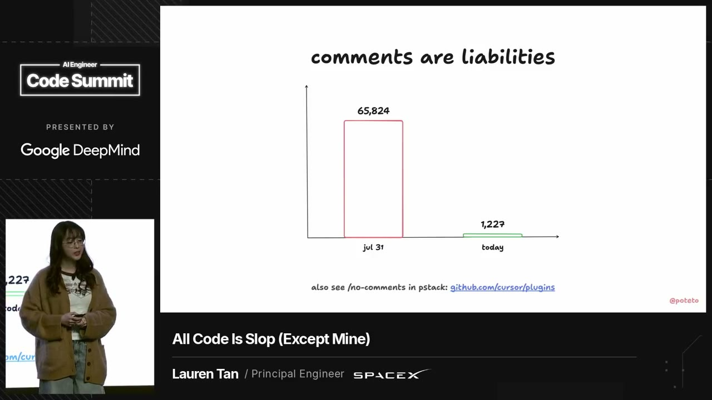
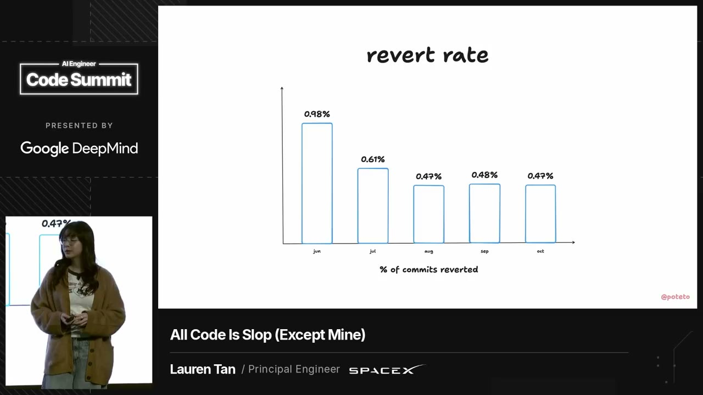

# 别往 agents.md 里再加一行规则，一个月发 3000 个 PR 的工程师把每次纠正 AI 都写进了代码

大家好，我是 Will-出海观察。

土豆女神在 SpaceXAI 做 Grok Bot，说自己上个月往生产环境发了 3000 个 PR。Grok Bot 团队 10 月合并了 10926 个，被回滚的提交占 0.47%。这些数字都是土豆女神在 AI Engineer Code Summit 的演讲里报的。17 分钟的演讲里，信息量最大的是土豆女神对待 AI 犯错的办法。AI 做错了，纠正它，土豆女神的第一步是想怎么把这件事变成一项确定性的检查，不往规则文件和 agents.md 里再加一行。

## 纠正 AI 的顺序要倒过来

土豆女神画过一个倒三角，叫 the poteto pyramid，回答的是怎么更信任 agent。自上而下是五层。代码库本身，包括 API 设计、架构和重构。静态分析，包括 lint、类型、编译器、测试和 CI。验证，分运行时和形式化两种。然后才是文字，也就是规则、skills 和 agents.md。最底下是人工评审。画面左边有个 cost 的箭头朝下，越往下越贵。

最上面两层，土豆女神叫它们确定性的层，直接用代码约束 agent，逼它默认就做对。验证用来找 bug，核对系统里该一直成立的性质，也看 agent 有没有听懂目标。文字放到最后，只叠一点，装那些要靠判断的东西。

所以每次纠正 agent，土豆女神先想能不能把它变成一项确定性的检查，不加到规则或 agents.md 里。代码里的检查更容易复现，也就更敢信它。agent 的输出由输入决定，代码库又是最大的输入之一。

代码库里的绕过方案、反模式、过时代码和技术债，下一个 agent 看到，会当成已经确立的写法抄走。土豆女神拿花园打比方，杂草一长，转眼到处都是。所以代码库要收拾得越干净越好，让 agent 抄的都是好东西。数量也在逼人这样做。土豆女神说 2024 年上班，要评审同事写的 3 个 PR，现在这个数在 300 上下，每个工程师都成了一队几百上千个 agent 的负责人。

## AI 用不好的东西，直接禁掉

先看 React 的 useEffect。它有用处，也常被滥用，有人开玩笑说得有博士学位才能用好。土豆女神的判断是，凡是要靠细腻判断才能用好的东西，容易出烂代码，而 agent 不擅长这种东西。Grok Bot 的做法是在产品代码里直接禁用，只有 Dune 框架的少数 API 里允许。这个问题就从根上消灭了，评审时再也不用盯它。

Dune 是 Grok Bot 的客户端框架，土豆女神说技术上不算有趣，可以当成 Electron 应用的 Next.js。有意思的是里面编进了大量约束和 lint 规则，装着做桌面应用学到的教训。画面上写着三条，每个功能一个文件夹，严格的导入禁令，代码里不写注释。

另一个教训来自 Cursor。那里的 agent 常把主线程的代码导入渲染线程，造成长任务和卡顿。Grok Bot 里干脆让目录结构当上下文。顶层有两个目录，名字就叫 electron-renderer 和 electron-main，两边互相导入，由依赖图分析器和几条规则禁掉。规则简单，换来评审时少盯一件事。

画面上还有个业余项目的例子，文件叫 tick.hot.ts，放在 sim 目录下，旁边标着每个 tick 都跑、不许分配内存。路径和文件名本身，就在告诉 agent 这是什么性质的代码。

## 一个临时补丁，不到六周长成 183 个定时器

Cursor 的代码库还给土豆女神上过另一课。agent 很爱用命令式定时器，setTimeout、requestAnimationFrame、requestIdleCallback，拿来当快速修补。它们在补一处架构冲突，VS Code 是命令式风格，React 是声明式风格，两边对不上。土豆女神的说法是，架构选择本身，让客户端和 agent 的性能都差了很多。定时器被大量创建和销毁，会触发频繁的垃圾回收，界面就卡。

画面上有一条时间线。9 月 9 日，一行 setTimeout 修好了一个闪烁，注释写着晚点释放，以防它回来，agent 给的理由是别的办法改动会更大。10 月 3 日，这一行被复制进一个共享模块。10 月 17 日，代码库里有了 183 个定时器。

比补丁更糟的是 agent 写下的注释，红字那些，都在解释这个快速修补为什么合理。土豆女神还见过 agent 把 markdown 当成地方，文档、注释、规则、skills 里都有，用来写下自己不做对的理由。有时 agent 对你的一次小纠正反应过度，把它当成永远不能打破的硬规则。

## 注释从 65824 条删到 1227 条

Grok Bot 吸取了教训，禁掉了 99% 的注释。土豆女神给了几个理由。注释容易过期。人通常也懒得读那一堆注释。注释还给 agent 留了一个借口，遇到难题，它就写一段话，证明不做对也说得过去。最后一点是注释管不住任何事，想靠一条注释告诉下一个 agent 别这么干，最后没有一条能信。

取代它的是 lint 规则。报错信息写得很清楚，让 agent 去修根因，不要绕着补。

画面标题是注释是负债，柱状图没标单位，应该是注释的数量，7 月 31 日 65824，演讲时 1227。旁边写着 pstack 里有个 /no-comments 技能，pstack 是土豆女神自己做的插件。

这也是土豆女神的总原则。每次纠正 agent，要么变成一项确定性检查，要么在代码里从根上消灭这个问题，靠更好的 API 设计和架构。做的次数够多，评审要盯的东西越来越少，到某个时候发现没什么好审的了，就可以让 agent 自己合并大多数 PR。

## 验证会吃掉大部分 token

Grok Bot 团队的代码评审，现在主要看验证产物，视频、截图、图表和形式化验证的结果。

最基础的是运行时验证，意思是给 agent 一个办法自己跑代码，用开发者调试用的工具，比如 Chrome DevTools 协议。土豆女神的运行时验证技能里有两样东西。一样叫 feature map，从用户视角列出应用里所有的功能，类似 sitemap。用户说左边栏那个东西，agent 不用猜，双方有了共同的词汇。另一样是自定义 CLI，agent 每次复用同一个 CLI 和驱动，省 token，也能测试。

画面上 CLI 的例子，是点一个叫 Settings 的控件，抓一份界面快照，再截一张证明用的图。

形式化验证是最近才开始的。团队用 TLA+ 对主要用户流程做模型检查，比如通知在多个设备和平台上的行为。用 Lean 证明某些算法，团队自己写了一个虚拟列表库，就拿 Lean 检查它有没有闪烁和抖动。这个办法已经抓到不少 bug，土豆女神说它不是银弹，只是 agent 环境里的又一层，团队还在试。界面上还试了基于属性的测试，用一个叫 Bombadil 的库，也抓到过几个界面 bug。

验证花的钱，土豆女神引了 Cindy Sridharan 的两条推文来说。2026 年 5 月 15 日，Cindy 说同一周里有好几个带细微 bug 的 AI 生成 PR 被合并，花了好几天修，速度并没有涨。11 月 5 日，Cindy 又说，半年前流程里缺的就是现在用的验证。每天 70% 的 token 花在验证补丁上，只有 20% 到 30% 用来写。土豆女神说自己也一样，大部分 token 都花在验证上。

土豆女神说这套流程里的东西，全是好的软件工程工具，早就有了，只是以前太贵，难理解也难维护。agent 把成本压了下来，土豆女神管这叫测试和验证的黄金时代。土豆女神还做了个 State Chart 技能，放在 pstack 里，从用户视角把状态机画出来，和视频、截图放在一起评审更容易。

## 别自动化一个烂循环

土豆女神给想搭软件工厂的人一条建议。在把能自动化的都自动化之前，每次纠正 agent，先改代码库。先写一条 lint 规则，防止这个反模式再出现，再去清理已有的旧写法。验证也要做扎实。这些本来就是自动化的前提。内层写代码的循环如果产出烂代码，把它自动化，只会产出更多烂代码，还得砸越来越多的 token，那是很贵的。

速度涨了，会不会一团糟。画面上是被回滚的提交占比，6 月 0.98%，7 月 0.61%，8 月起稳定在 0.47% 左右。这个数只统计被撤销的提交，没被发现的问题不在图里。

其他数字也都是土豆女神报的。10 月有约 227 个人至少提交过一个 PR，不少是没有多少背景的顺手贡献者。客户端大约每天切出一个稳定版。启动、打字、开新对话、切换对话，都比刚发布时快。Grok Bot 现在还是个 Electron 应用，土豆女神承认有天花板，但说它已经比很多别的 agent 界面快了。

讲到最后，土豆女神介绍了 Grok Bot 的连接器、routines 和 projects，说可以调度成百上千个 agent，这几句是产品介绍。随后举了个例子。每次发新版，Grok Bot 会自动开一个 Cursor project，把整个构建 fuzz 一遍，像真实用户那样跑应用找 bug，给每个 bug 开修复 PR，再自动合并。听上去有点疯，土豆女神说能这样，是因为代码库够好，PR 默认就是好的，现在落地的产品代码大多不再需要深度人工评审。

土豆女神用了六个月，才走到一个月能发几千个 PR，不少是睡觉时合并的，说你会比这快得多。

看到这了，点点关注👇
