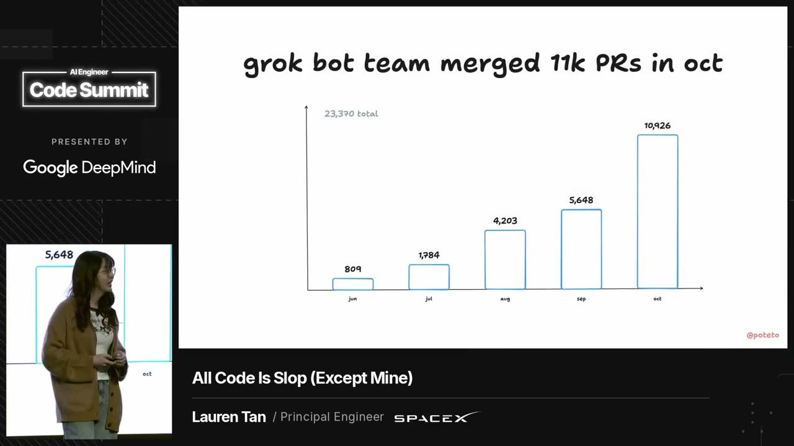
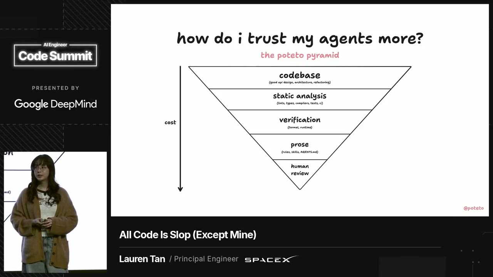
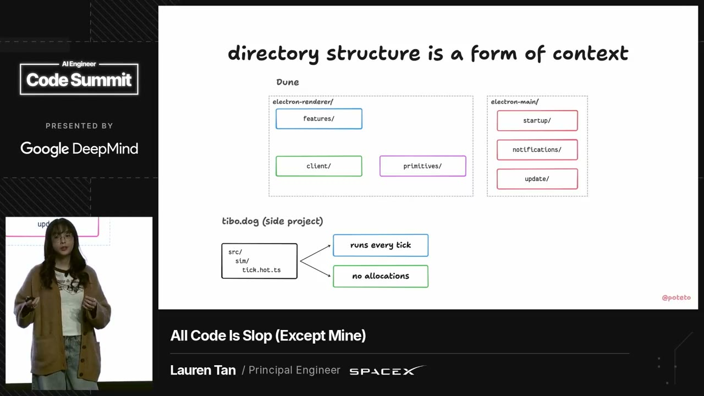
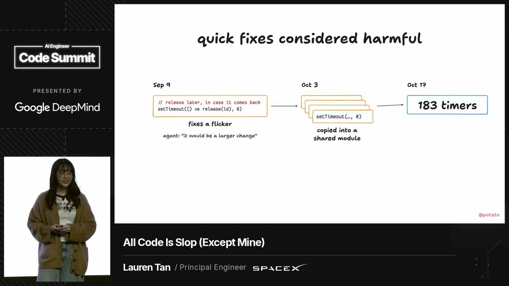
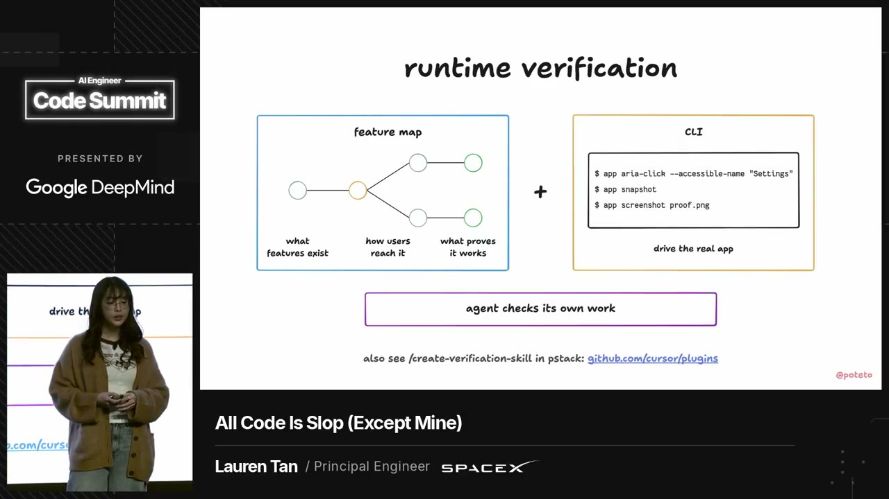

# Codex 剪视频总犯同一个错，别再往 AGENTS.md 里加规则，SpaceXAI 一个月发 3000 个 PR 的工程师，有五条做法能搬走

大家好，我是 Will-出海观察。

AI 做错了，土豆女神纠正完以后的第一步，是想怎么把这件事变成一项确定性的检查。往 AGENTS.md 里加一行规则，在她的顺序里排得很靠后。

土豆女神在 SpaceXAI 做 Grok Bot，说自己上个月往生产环境发了 3000 个 PR。Grok Bot 团队 10 月合并了 10926 个，被回滚的提交占 0.47%。这些数字都是她在 AI Engineer Code Summit 的 17 分钟演讲里报的。

Grok Bot 这边，10 月有约 227 个人提交过 PR，独立开发者碰不到这个规模。可她对付 agent 犯错的办法，一个人也能用，用 Codex 写脚本剪视频的人尤其合适，因为成片有一部分好坏可以直接量，分辨率、时长、音量、字幕字数都能让程序自己查。我从演讲里挑了五条，剪视频的例子是我搬过去的，她讲的全是代码。

## 每次纠正之前，先把几个问题过一遍

土豆女神画过一个倒三角，叫 the poteto pyramid，回答怎么更信任 agent。自上而下五层。代码库本身，包括 API 设计、架构和重构。静态分析，包括 lint、类型、编译器、测试和 CI。验证，分运行时和形式化两种。然后才是文字，也就是规则、skills 和 AGENTS.md。最底下是人工评审。画面左边的 cost 箭头朝下，越往下越贵。

她管最上面两层叫确定性的层，直接用代码约束 agent，逼它默认就做对。理由很朴素。代码里的检查可以复现，所以敢信它。agent 的输出由输入决定，代码库又是最大的输入之一。里面有绕过方案、过时写法和技术债，下一个 agent 看到，会当成写法已经定了，照着抄。

放进剪视频，就是每次纠正之后按层往下问。假如 Codex 又把竖屏字幕压到了画面底部的按钮区，你手边那句“字幕别放太低”先别写。先看字幕位置是不是只从一份配置里读，要是每个脚本各写各的坐标，先把它们收成一处，错坐标就没有地方可写。再往下，渲染时能不能在字幕越界时直接报错，渲染完能不能抽一帧让它自己对一眼。这些都做不到，才轮到写那句规则。最后才是你自己盯着成片看，那是最贵的一步。

## 它用不好的东西，直接禁掉

先看 React 的 useEffect。它有用处，也常被滥用，有人开玩笑说得有博士学位才能用好。土豆女神的判断是，凡是要靠细腻判断才能用好的东西，容易出烂代码，而 agent 不擅长这种东西。Grok Bot 在产品代码里直接禁用，只有 Dune 框架的少数 API 里允许，评审时再也不用盯它。

Dune 是 Grok Bot 的客户端框架，里面编进了大量约束和 lint 规则，画面上写着三条，每个功能一个文件夹，严格的导入禁令，代码里不写注释。

目录结构也拿来当上下文。Cursor 那边，agent 常把主线程的代码导入渲染线程，造成长任务和卡顿。Grok Bot 的顶层干脆设了 electron-renderer 和 electron-main 两个目录，两边互相导入，由依赖图分析器和几条规则禁掉。画面上还有个业余项目的例子，sim 目录下有个叫 tick.hot.ts 的文件，旁边标着每个 tick 都跑、不许分配内存。路径和文件名本身，就在告诉 agent 这是什么性质的代码。

剪视频里我会先找两个地方下手。一个是原始素材。剪辑脚本最容易出的事故是原地覆盖，输出路径写错一个字，原片就没了。把素材目录设成只读，写错的那一刻系统就会报错，原片碰不到。每期再分 raw、work、out 三个目录，目录名先告诉 Codex 哪些东西能随便重新生成，哪些碰不得，这就是 tick.hot.ts 的用法。

另一个是 ffmpeg 的滤镜链。它在剪视频里最像 useEffect，能用，也要靠判断，参数错一位，画面发糊或者音画错开。我会把它收进一个渲染入口，整个项目只有这里允许出现 ffmpeg，别的脚本里再冒出来，一条 grep 就能让检查失败。毛病都集中在一处，好查，也好修。

## 一行临时补丁，不到六周长成 183 个定时器

Cursor 的代码库给土豆女神上过另一课。agent 很爱用命令式定时器，setTimeout、requestAnimationFrame、requestIdleCallback，拿来当快速修补。它们在补一处架构冲突，VS Code 是命令式风格，React 是声明式风格，两边对不上。定时器被大量创建和销毁，会触发频繁的垃圾回收，界面就卡。

画面上有一条时间线。9 月 9 日，一行 setTimeout 修好了一个闪烁，注释写着晚点释放，以防它回来，agent 给的理由是别的办法改动会更大。10 月 3 日，这一行被复制进一个共享模块。10 月 17 日，代码库里有了 183 个定时器。

她说比补丁更糟的是 agent 写下的注释，都在解释这个快速修补为什么合理。她还见过 agent 把 markdown 当地方，文档、注释、规则、skills 里都有，用来写下自己不做对的理由。Grok Bot 吸取教训，禁掉了 99% 的注释，数量从 7 月 31 日的 65824 条降到演讲时的 1227 条。取代注释的是 lint 规则，报错信息写得很清楚，让 agent 去修根因，不要绕着补。

这件事换到剪辑脚本里，大概长这样。某一期音画差了一点，Codex 在这期的脚本里加了一个固定偏移，把它对上。下一期它拿这份脚本当模板，偏移跟着走，再下一期也是。我会从这里抄两样。

一样是报错信息的写法。检查失败时输出的那句话，Codex 下一轮就会读到，它本身就是一次纠正。所以别只写“字幕超长”，写成第几条字幕多少个字、上限多少、请拆句，再加上你最担心它走的那条近路，比如不许靠缩字号解决。另一样是把它写下的辩解当报警。脚本里一旦出现“暂时”“先这样”“workaround”这类词，让检查直接失败，逼它回头去找音画差的根因。

99% 的注释我不会整个照搬，一个人的脚本库，注释还要留给半年后的自己看。借用的是她看注释的角度，agent 开始给自己的做法写理由，多半说明它正在绕路。

## 验收别看成片，看它交上来的证据

Grok Bot 团队的代码评审，现在主要看验证产物，视频、截图、图表和形式化验证的结果。

最基础的是运行时验证，意思是给 agent 一个办法自己跑代码，用开发者调试用的工具，比如 Chrome DevTools 协议。她的运行时验证技能里有两样东西。一样叫 feature map，从用户视角列出应用里所有的功能，类似 sitemap，用户说左边栏那个东西，agent 不用猜，双方有了共同的词汇。另一样是自定义 CLI，agent 每次复用同一个 CLI 和驱动，省 token，也能测试。

验证花钱。她引了 Cindy Sridharan 的推文，说每天 70% 的 token 花在验证补丁上，写只占 20% 到 30%，她自己也一样，大部分 token 都花在验证上。她还说这套流程里的东西全是好的软件工程工具，早就有，只是以前太贵，难理解也难维护，agent 把成本压了下来。

剪视频这一层很好搬。我会让 Codex 每次渲染完交三样东西。一份 ffprobe 的报告，分辨率、帧率、时长、有没有音轨，和你预期的比一遍。一份检测结果，ffmpeg 自带的 blackdetect 能找黑屏，silencedetect 能找长静音，ebur128 能测出整体音量。还有一张按固定位置抽帧拼成的缩略图，开头第一帧、每个章节的开头、字幕最长的那几句、最后一帧。你看这张图和那几行数字就行，十分钟的片子不用从头看到尾。

feature map 也能照抄。把片子里的每个元素起个名字，列成一张表，顶部章节条、左上徽章、字幕条、封面，每个名字旁边写它在哪个文件、哪个参数控制。你说“把左上那个调小一点”，Codex 就不用猜是哪个。检查脚本也不用自己一行行写，让 Codex 写一遍，你审一遍。她说的“以前太贵”，落到这里就是自己写这些脚本的那几个小时。

她的团队还用 TLA+ 对主要用户流程做模型检查，用 Lean 检查自己写的虚拟列表库有没有闪烁和抖动，抓到过不少 bug。她说这不是银弹，团队还在试。这两样独立开发者可以先放一放，我的看法是学它们的成本，一个人的项目用不回来。

## 别自动化一个烂循环

土豆女神给想搭软件工厂的人一条建议。在把能自动化的都自动化之前，每次纠正 agent，先改代码库。先写一条 lint 规则，防止这个反模式再出现，再去清理已有的旧写法。验证也要做扎实。内层写代码的循环如果产出烂代码，把它自动化，只会产出更多烂代码，还得砸越来越多的 token。

速度涨了会不会一团糟，画面上是被回滚的提交占比，6 月 0.98%，7 月 0.61%，8 月起稳定在 0.47% 左右。这个数只统计被撤销的提交，没被发现的问题不在图里。

客户端大约每天切出一个稳定版。她演讲最后举了个例子，每次发新版，Grok Bot 会自动开一个 Cursor project，把整个构建 fuzz 一遍，像真实用户那样跑应用找 bug，给每个 bug 开修复 PR，再自动合并。她说能这样，是因为代码库够好，PR 默认就是好的。

想挂定时任务批量出片的人，先看一件事，同一期片子，你有几次是一帧不改就能发的。没有连续几期做到，就别排班。我还会在项目里放一份纠正清单，每次纠正 Codex 记一行，同一条出现第二次，就必须变成一个检查或一处代码约束，不许再写成规则。这份清单是我加的，她没讲过。

土豆女神自己用了六个月，才走到一个月能发几千个 PR，不少是睡觉时合并的。她说你会比这快得多。

看到这了，点点关注👇
