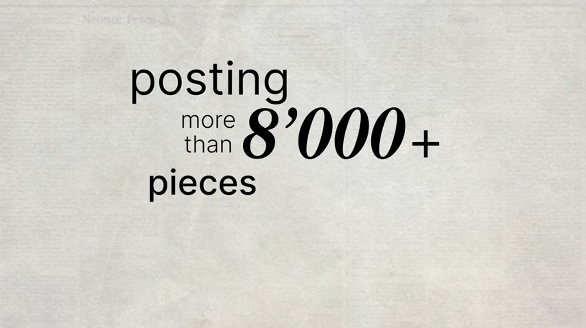
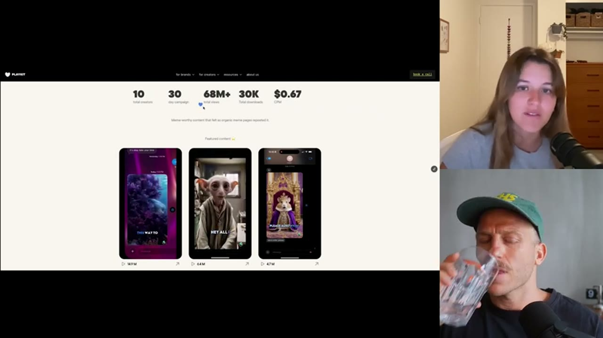
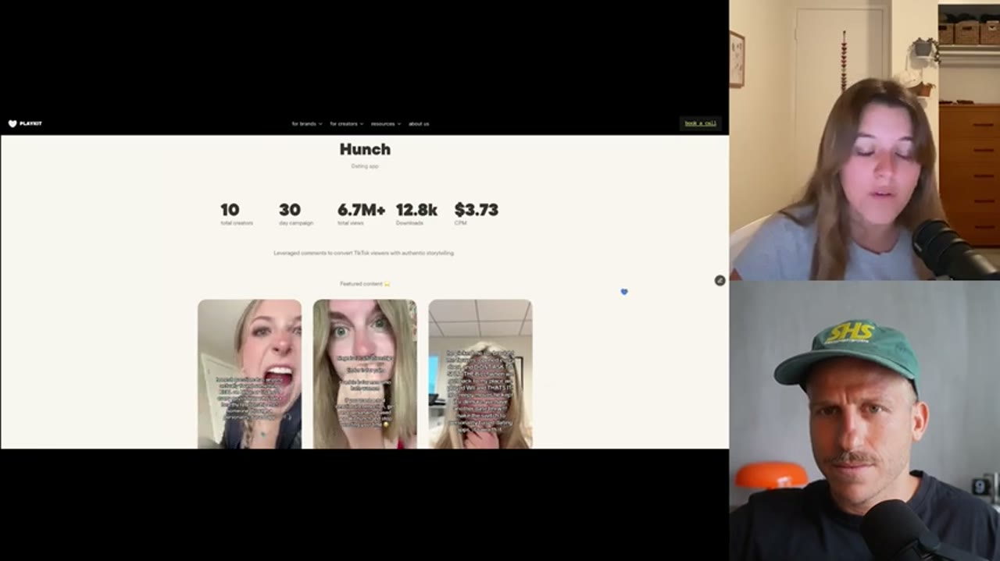

# 没投广告，没找网红，一个人发 TikTok 做到 50 万下载，Playkit 联合创始人把流程讲了一遍

大家好，我是 Will-出海观察。

这期是一档 YouTube 访谈，37 分钟。嘉宾 Julia 是 Playkit 的联合创始人，Playkit 帮 Substack 这类消费级 App 在 TikTok 和 Instagram 上批量发短视频，Julia 说每月发 8000 多条。Julia 早年在一家创业公司做增长，据说没投广告也没找网红，一个人每天发几条视频，把 App 做到了约 50 万下载，这期讲的就是这套从零开始的做法。

## 哪类产品适合，哪类不适合

UGC 是 user generated content，这里指请普通人用真人口吻拍的短视频，做得像朋友在推荐产品，不像品牌在打广告。Julia 的说法是，UGC 从内部融进目标用户的社区，付费广告则是从外面往里推。

不过 Julia 先给了一个提醒，这个渠道不是每个产品都能用。Playkit 现在挑客户很严，只接觉得能在社交平台上爆的，多是关于感情、钱、职场和学业提升的消费级工具。常有加密货币和 B2B SaaS 的公司来找，Julia 的回答是这个渠道不适合。B2B 可以做创始人出镜的内容，讲自己在做什么品牌，拍一天的生活，UGC 的效果就差一些，因为上班族刷 TikTok 是为了放松，不会为了工作去刷。

创作者要和目标用户长得像。这股风潮从大学生开始，因为大学生好找、反应快、价格低，也想接活。Playkit 还和很多全职妈妈合作，家庭类产品的效果不错。年龄再往上，或者偏男性的产品，会难一些，很难一次找到好几位熟悉 TikTok、又能稳定出好内容的 50 岁男性，Julia 建议这类产品走网红或付费广告。

产品本身也要有东西可传。Julia 举的例子是 Cantina，一个 AI 视频生成工具，据说是 Sean Parker 的公司。他们发的内容被 Instagram 上的梗图账号当成段子转发了出去。

画面上标的是，10 个创作者做了 30 天，6800 万以上播放，3 万下载，CPM（每千次播放的成本）0.67 美元。Julia 说这个 CPM 是纪录级的低，很少见。结论是，产品里最好自带会被传播的设计。现在教人做营销的资料很多，独立开发者常常漏掉这一步。

## 从零粉丝开始，先做三件事

Julia 提到的 50 万下载，是在一家创业公司做增长时的结果，访谈里没说是哪个产品，只说了快，没说花了多久。

主持人问，TikTok 账号一个粉丝都没有，第一个下载从哪来。Julia 给了三步。

1. 先把目标用户想清楚，还要给他们起个名字。Julia 常反问来找自己的人，目标用户是谁，很多人答不上来。而不知道他们是谁，就谈不上找到他们。
2. 新号先养号。去 For You 页搜目标用户会搜的词和问题。Julia 举的例子是一个给刚搬到纽约的人办活动的 App，要搜 how to make friends in a new city 和 events in NYC around me 这类词。这样发出的视频才会推给对的人，也能看到这个领域里什么内容在传播。
3. 账号做成用户的样子，不挂品牌。头像用将来发视频的那个真人的脸，简介写成目标用户自己会写的话。目的是让观众看不出这是广告，有时视频里连产品名都没有，转化多发生在评论区。Julia 把创作者当成演员，说这样转化率往往最高，因为观众觉得是自己发现的。

第一条视频拍什么，Julia 的答案是复刻已经跑得好的。竞品发过的爆款，照着拍，把自己的产品放进去。领域里生活类博主的爆款也一样，想办法自然地带进产品。主持人举了一类 App，朋友或情侣之间拍张照，照片直接出现在对方屏幕上。Julia 会先去看同类里最火的那个 App 在发什么，复刻它最爆的视频，再根据评论里大家对什么感兴趣、是什么样的人感兴趣，一点点调整。

主持人还问有没有固定结构，比如钩子、主体、行动号召。Julia 说以前好用，现在不行了，格式死得很快。先抛钩子再演示，或者目标人群加痛点等于解决方案，都是以前有效、被太多人复制之后失灵的。观众越来越精，一旦看出是广告就划走。Playkit 现在更多做口播、连载系列和图文轮播，前提是产品本身值得被注意。

## 评论区才是转化的地方

Julia 的说法是，视频像一个落地页，用来把一群人聚到评论区。控制住评论区，就能带着看视频的人去做想让他们做的事，比如下载 App。

做法有这几样。每条评论都回，以前还会给评论的人发私信，说一句自己在做一个什么 App。给高赞评论做视频回复。这样别人往下翻评论，看到全在聊这个 App，会有错过的焦虑（FOMO），自己去搜来下载。App Store 的截图和文案，也要和爆款视频的说法对上，让这一路体验连贯。

找用词的办法是，大量截图 TikTok 上的内容、评论、表情和标签，丢给 ChatGPT，让它归纳这群人常用的俚语和说法，再用进文案。

主持人问，评论能不能造。Julia 说 Playkit 有 150 到 200 个创作者，遇到爆款视频，就让他们去评论区发讨论 App 的评论。用 Discord 群也行，只要账号有头像。同时提醒别滥用，TikTok 会标记，只在评论本来就多的视频上做，才不显得突兀。

账号不挂品牌、评论造势这类做法，容易碰到平台对付费推广的规定，做之前先看清规则。

Hunch 是 Playkit 做的一个约会 App 案例，用的就是评论区。

画面上标的是，10 个创作者，30 天，670 万以上播放，1.28 万下载，CPM 3.73 美元。多数视频不提 App 名字，靠评论区讲故事。创作者先发一段糟糕的经历，问有没有别人也遇到过，别人开始讲自己的遭遇，创作者再进去留一句，用这个 App 就不会碰到这种事。Julia 说这样做对转化的帮助很大。

## 30 天没爆就继续，爆了就放大

发了 30 条，一条没爆，怎么办。Julia 的回答是继续。Playkit 给客户的节奏是每个创作者每周 15 条，每天 3 条，每周 5 天。前两周基本用来测试，第三、四周才开始看到爆。30 天是个合适的测试期，一直不行，有时是产品的问题，有时是策略没对。没有哪个技巧每次都灵。

有一条超过 10 万播放之后，Julia 的建议是同一个信息反复发，直到它不灵为止，中间改改措辞，或者从室外拍改成室内，换个角度展示产品。同时马上去评论区全部回复，给高赞评论做视频回复，内容围绕产品。TikTok 的机制是，爆款视频下的回复视频，会推给看过原视频的那批人，所以回复视频可以做得像传统广告，照样有很多播放和转化。这阵热度过去之后，再从评论里看大家对产品的看法和痛点，拿来做下一轮的说法。

两个平台怎么分。Julia 说 TikTok 更精准，转化更好，Instagram 播放可能更多，但更泛，转化低，更适合品牌曝光，偏男性的产品有时 Instagram 更好。内容基本可以一样，用排程工具两边同发，精力放在 TikTok，Instagram 当另一个落地页。

最常见的两个错误。一是视频爆了，没有下载，原因是内容和产品、领域没关系。二是放弃得太早。

## 找创作者，定价钱，做管理

天天发三条，自己又要做产品，就得招创作者。Julia 说最好的办法是发一条 TikTok，写清产品和想找的人，会有稳定的人来找，也可以主动联系，能更挑人。创作者超过 3 到 5 个，就该找一个策略和管理的人，要审视频、给策略、分析数据。

怎么判断好坏。要找爆过、做过内容的人，不管内容是给别的 App、TikTok 小店，还是自己账号做的。还要熟悉 TikTok，对产品有兴趣，回复快。多数情况下招来的是执行者，策略还是自己定。所以要先自己做一遍，再让别人照着复刻。

价格上，Julia 说行业常见是每周 125 到 175 美元，发 15 条，再加奖金。奖金是播放过 10 万给 100 美元，过 50 万给 500 美元，过 100 万给 1000 美元。Julia 没说这是哪个国家、哪类创作者的价格。回本要想得长期一点，但别太长。扩大创作者之前，先确认付费转化够稳，心里要有数，付创作者多少钱，拿到多少播放，大概换来多少收入，不能把所有东西扔上墙看看会怎样。这一块 Julia 没做产品那一侧，说不出转化率该是多少。

管理上，Playkit 自己做了一套软件叫 UGCTrackr，内部用。能看谁今天发了，漏发会提醒，自动算该付多少钱，创作者上传视频后审核、给修改意见，创作者也有自己的入口。Julia 的话是，用表格再找助理数每个人发了几条，很快就乱了。Playkit 有 150 个创作者，每月发 8000 多条，所以自己做了这套。Julia 顺带推荐了这个工具，当广告看就行。

看到这了，点点关注👇
