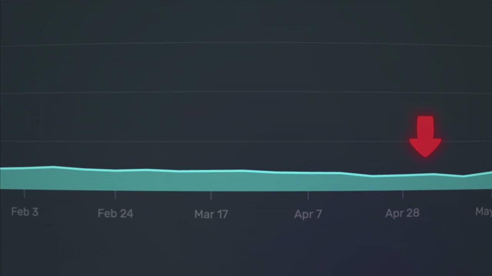
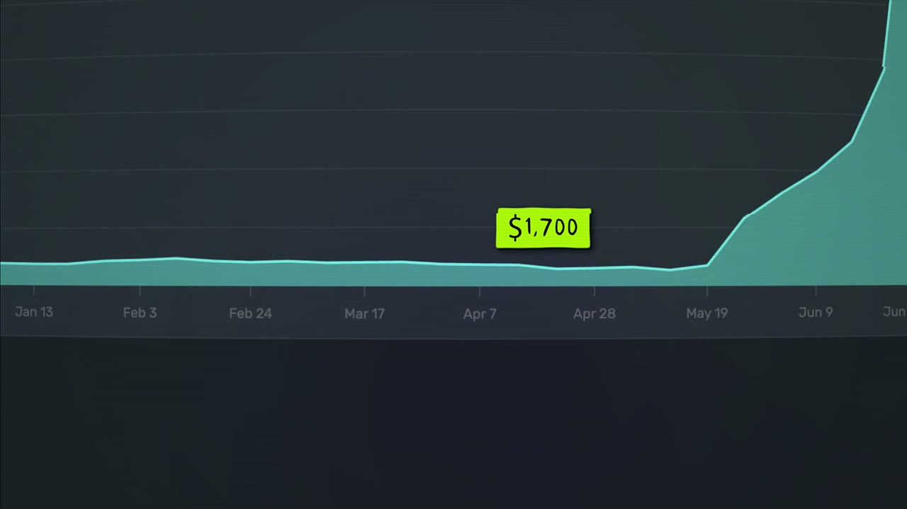
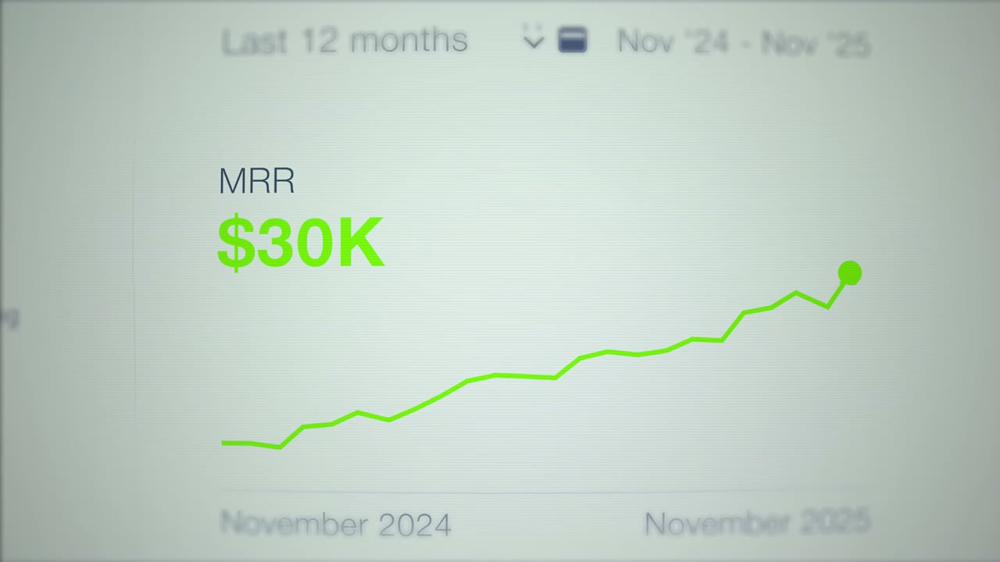
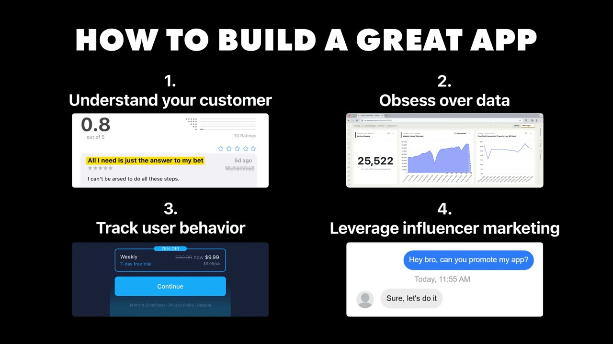
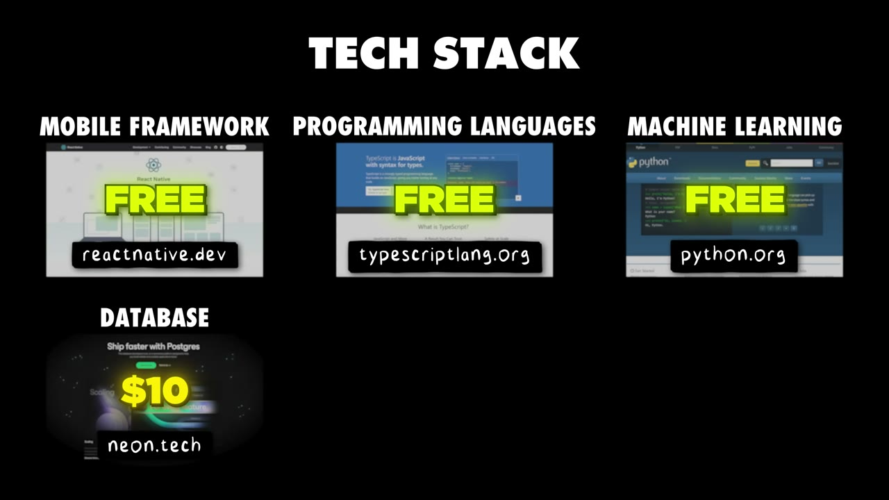
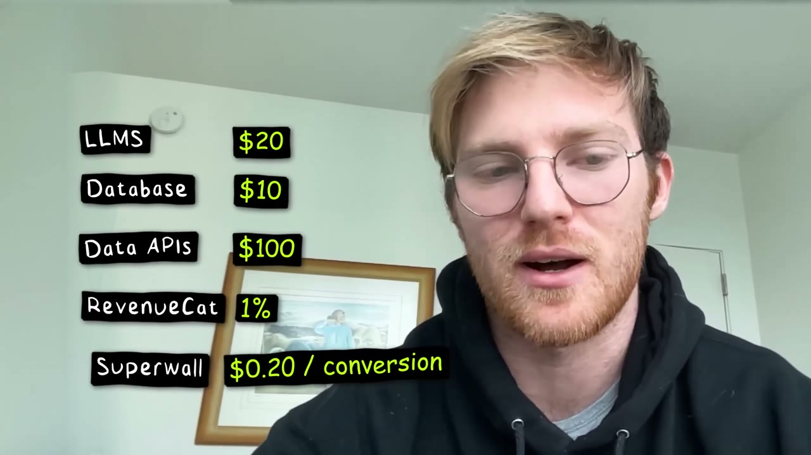

# 卡在月收入 2000 美元，两个大学生停掉营销重做 4 个月，后来做到 3 万

大家好，我是 Will-出海观察。

这期看的是 Starter Story 的一个访谈，11 分钟。嘉宾是 Eyal 和 Yali，两个大学生，做了一个叫 PropGPT 的 App。它的故事和很多人相反，推广早早跑通了，产品却没人留下。

## 推广跑通了，钱没涨

PropGPT 是个体育数据分析 App，用他们自己的机器学习模型给出每天的预测，用户可以看现成的分析，也能自己输入选择来对照。

第一个版本他们做了大约五个月。那时 ChatGPT 刚出来，进度慢，上线时赶上去年 NFL 赛季中段。他们一开始就找了网红推广，花了几千美元，每天大约 20 个下载，转成 5 到 10 个试用用户，下载到试用的转化率很高。

问题出在后面。MRR 一直停在 1000 到 2000 美元，上不去。Yali 说的那句话很直接，产品要是烂，没人会买。

## 他们怎么看出产品有问题

他们的判断来自数据和聊天。在 Superwall 上，进试用的人很多，试用结束后几乎没人留下，45% 的人开了试用，只有 13% 的试用用户转成付费。

Eyal 对这个数字的解读我觉得讲得清楚。用户觉得这个想法不错，觉得对生活有用，可一用起来，体验和期待的不一样。

再用 PostHog 这类分析工具加上和用户聊天，他们看到了原因。用户要的是直接拿到答案，不想自己去各个平台上输入选择、对照判断。

## 停掉营销，重做 4 个月

于是他们关掉了所有营销，花四个月只做工程和设计，把产品改成直接给出答案。新版本 4 月 15 日上线，当时 MRR 是 1700 美元，每天约 15 个下载。

下一个月他们重新全力投入营销，赶上 NBA 季后赛。这次付费转化率超过 50%。视频开头说，新版上线后 10 周做到月收入 3 万美元。再往后两个半月左右到了峰值，月收入 4 万美元，单日下载 2000。

现在的数据是下载 4 万多，付费用户 3000 多，试用转化率 48%，平均每个下载用户带来约 3.3 美元收入。

## 他们给的四步

1. 弄清楚你为谁做，他们的痛点是什么。
2. 听数据。他们盯的是两个数，45% 进试用，13% 试用转付费。
3. 盯分析。看用户在新手引导哪一屏流失，就知道哪一屏没把 App 卖好。记录所有功能点击，能看出最吸引人的价值点，再把它写进营销里。
4. 产品做好以后，用网红和自然内容放大。他们的第 70 条视频跑到 60 万播放，ARR 在三天里从约 8000 美元涨到 3.8 万美元。

## 技术栈和成本

用 React Native 写 App，TypeScript 和 Python 做主要开发，Python 负责机器学习和自动抓数据，数据库放在 Neon，收入看板和付费墙用 RevenueCat 和 Superwall。

成本他讲得很细。

- Superwall 每次转化 0.2 美元，RevenueCat 收 1%。
- 实时体育数据 API 每月约 100 美元。
- 数据库每月约 10 美元，大模型费用每月约 20 美元。
- 营销每月约 1 万美元。

算下来利润率大约 50%。

## 我的几点看法

这个案例里我最想拿走的是顺序。多数人是产品做对了，推广没做通，他们反过来，推广做通了，产品没做对，最后靠停掉营销、集中重做才翻身。

看数据时，他们抓的是两个数，进试用和试用转付费。进试用 45%、转付费 13%，一对比就知道问题出在试用之后。你自己的 App 也可以先看这一对数。

Pat 在结尾总结，产品和推广两样都得做好才能长久，这一点我同意。

看到这了，点点关注👇
