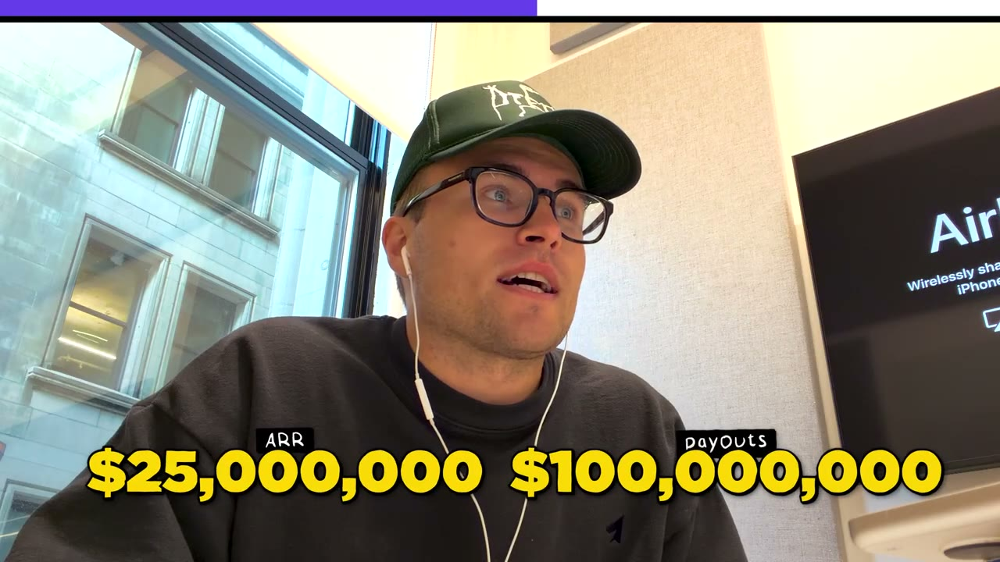
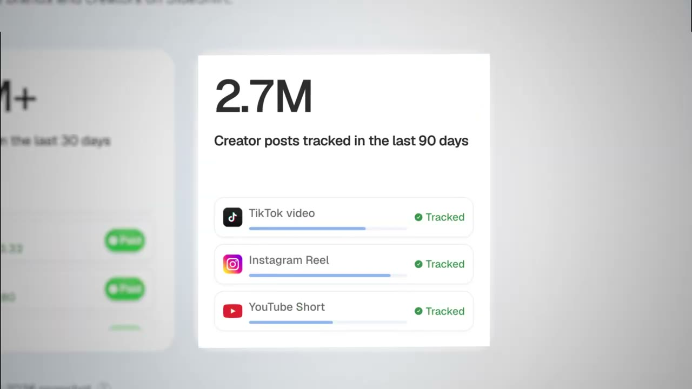
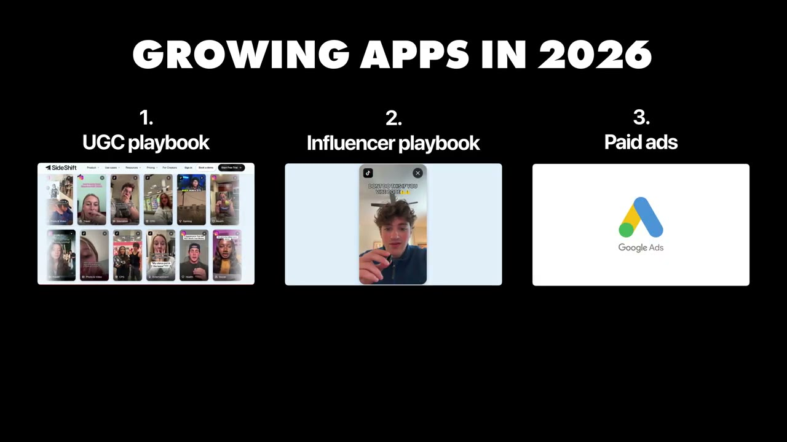
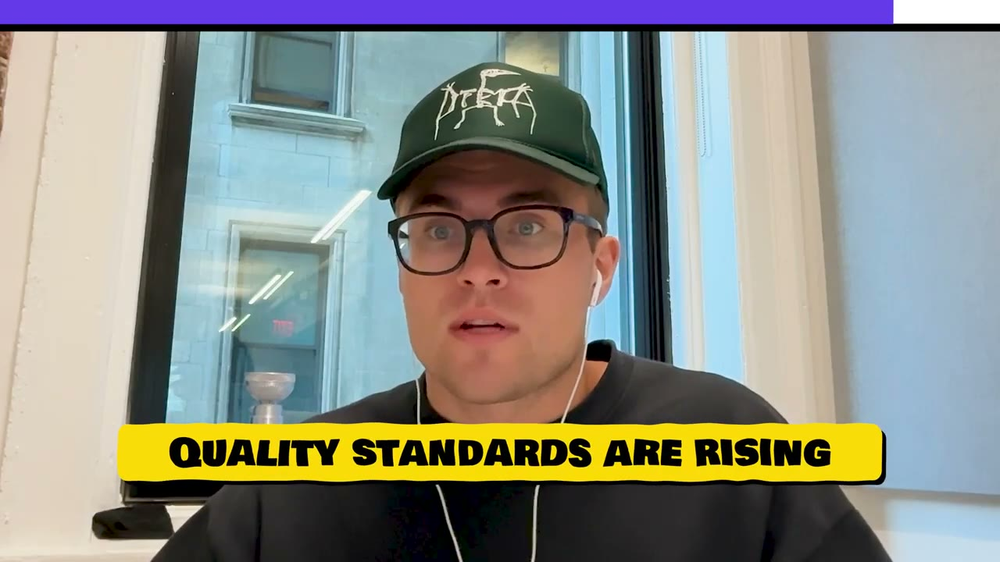

# 两年做到 2500 万美元收入，UGC 平台创始人说 2026 年给 App 找增长，只靠创作者视频不够了

大家好，我是 Will-出海观察。

这期看的是 Starter Story 的一个访谈，不到 10 分钟。嘉宾 Canyon 是 SideShift 的联合创始人，这个平台帮品牌找创作者拍短视频，据他说两年做到了 2500 万美元年收入。他讲的是 2026 年给 App 找增长，哪些做法还管用，哪些已经不灵了。

## SideShift 是做什么的

Canyon 的说法是，SideShift 既是 UGC 的撮合平台，也是管理工具。UGC 是 user generated content，一般指普通人拍的、像真人分享的短视频，品牌付钱请他们拍。品牌在平台上找创作者，再把人拉进自己的投放活动里。创作者从大学生到带孩子的爸妈都有。

数字都是他自己说的。平台上线两年多，创作者有 150 万出头，合作的品牌 3000 多家，今年年收入 2500 万美元出头，付给创作者的钱会超过 1 亿美元。画面上还有一个数，过去 90 天平台追踪了 270 万条创作者发的帖子，覆盖 TikTok、Instagram Reels 和 YouTube Shorts。

Gus 问他，UGC 这两年为什么起来。他讲了两点。做生意的人比以前多，起步也比以前便宜。想给自己干、自己安排时间的人也在变多，品牌和创作者两边都是这样。

访谈中间 Starter Story 推了一份和 HubSpot 做的免费短视频增长手册，那一段当广告看就行。视频开头主持人说几乎所有成功的 App 创始人都在用 SideShift，这句话视频里没给依据，嘉宾又是平台创始人，听的时候留点余地。2500 万美元是 Canyon 说的年收入，视频里没拆利润。

## 现在管用的，是三条线一起跑

Gus 问现在什么管用。Canyon 说，UGC 作为分发的形式，确实仍然管用。接着他补了一句，做得最好的品牌同时跑三条线，UGC、传统的网红合作和付费广告。

三条线要互相通气。他们会看，哪类创作者和哪种说法的数据好，哪种内容形式除了带播放量，还能带来后面的转化。这样就不用靠运气去赌一笔 5000 美元的网红合作，已经知道哪套做法在创作者身上跑通了，再下更大的注。

放大的顺序是这样的。UGC 和网红两边各自会跑出表现好的内容，把这些拿去投成付费广告。自然流量带来的播放照常拿，投广告这一头又能把后面的转化数据追回来，也就是他说的归因（attribution）。整场访谈里他没举一个具体 App 的数据，讲的都是做法。

## 去年的红利期过去了

Gus 接着问，有什么变了，什么不灵了。Canyon 说，一年前是红利期，很差的创作者、不懂行的品牌发很烂的内容，照样能爆，照样能带来转化。现在做 App 的人多了，用创作者的人也多了，竞争变大，观众对哪些东西像广告也有了更强的判断。他举的例子是，一年前转化率 1% 的内容，现在可能只有 0.1%。

格式也在变。一年前人人都在拍同一种，屏幕上叠一行字，开头抛一句抓人的话（hook，钩子），再演示产品。他认为现在最能打的仍是更长的故事型内容，有一段很紧的故事，能一直抓住观众，放在信息流里很显眼。

质量门槛一直在抬。他判断能吃到大头的品牌，会把刚入行或刚接触 UGC 的创作者带成能稳定出片的人。

## 刚起步的人怎么做

Gus 问，如果给刚起步或者有点起色的人建议，他会怎么说。Canyon 先分了两种情况。

只想先把东西推上市场、多试几次的人，去找一个已经跑得不错的领域或 App 类型，想办法把那个产品做得更好一点。不用重新发明轮子，改一改就行。

想做一家长期公司的人，打算干五年以上的那种，照搬这条路就没那么管用了。要选一个自己生活里有的问题，或者看到很多人在讲的问题，尽快把产品推出去，交到用户手里，从第一天就开始改。产品得有差异，至少比别人的好 10 倍。

最后一条他说得最重，个人品牌，这个词他连说了三遍。没钱请创作者，就自己发内容，Twitter、LinkedIn、Instagram、TikTok 哪个都行，哪个渠道可能有用户就发哪个。他说这是最长线的资产，合作过的公司里这样做的，涨得比不做的快。

自己发内容迭代一阵之后，再去投别的渠道。UGC 起步便宜，他建议先找 3 个、5 个或 10 个创作者，把关系处好，最好是产品的重度用户，或者真喜欢你在做的东西的人。刚开始做不能规模化的事，等有东西跑通了，再想怎么放大。

访谈最后，Gus 问他想对刚创业的人说什么。他说人是在做中学的，再多的建议也没法替你上手。他引了一句话，动起来的笨蛋，比原地不动的天才走得远。

看到这了，点点关注👇
