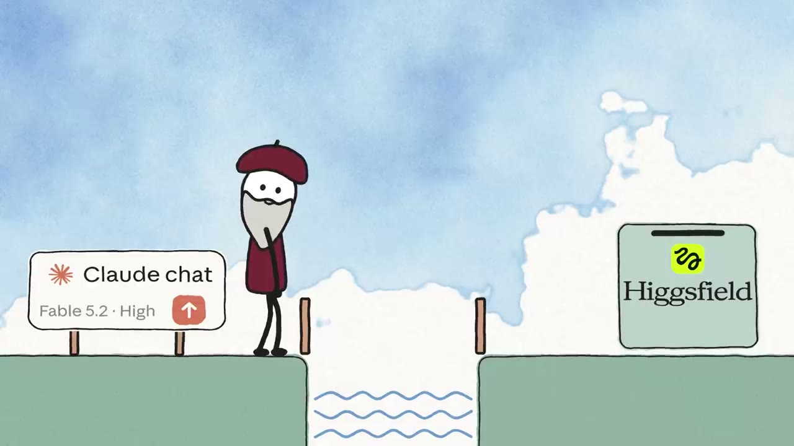
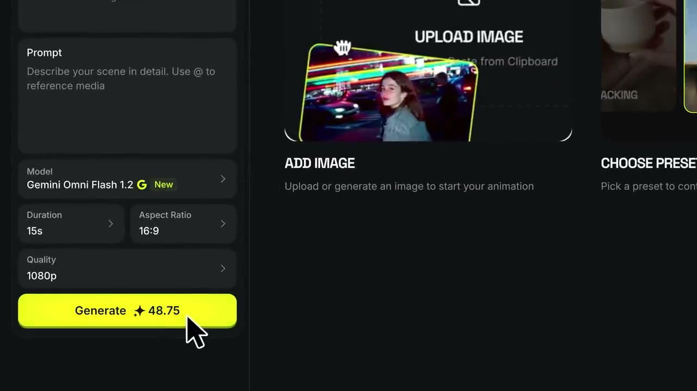
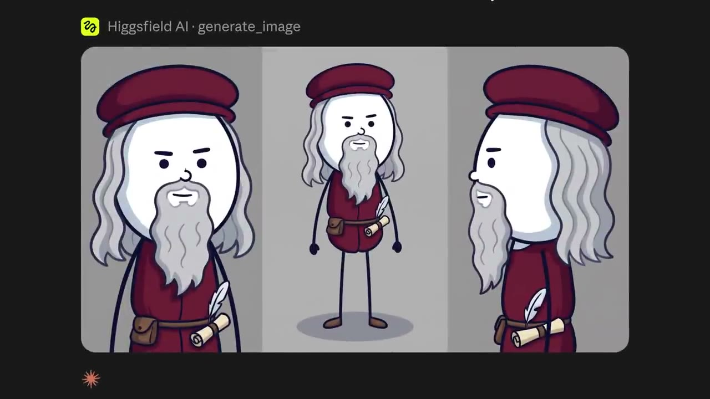
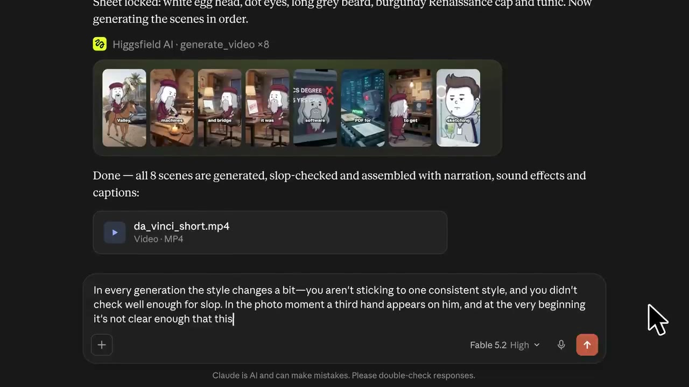
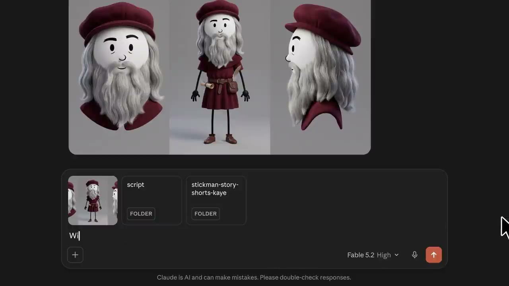
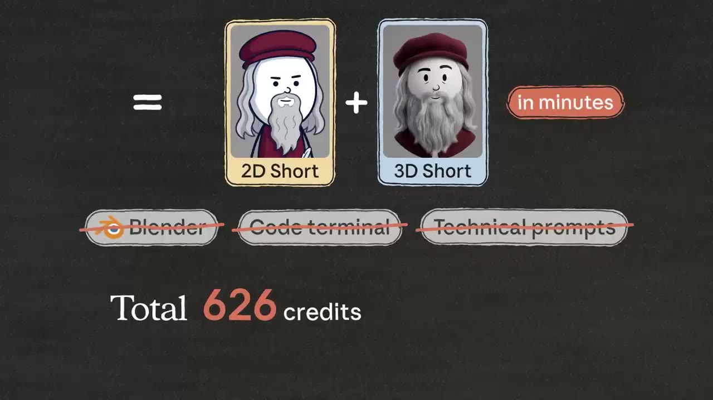

# 火柴人动画短片不用 Blender，聊天窗口接 Higgsfield MCP，2D 加 3D 两条一共 626 个 credits

大家好，我是 Will-出海观察。

同一个达芬奇去硅谷找工作的火柴人故事，My Creative Space 频道的 Kareema 用三种办法各做了一遍。接 Blender 那条路，据 Kareema 说做一条短片就能烧掉 20 万到 30 万个 Claude token，成片还不满意。留到最后的做法最省事，只用 Fable 5.2 的普通聊天窗口，接上 Higgsfield 的 MCP。2D 版约 336 个 credits，3D 版 290 个，画面上标的合计 626。我看下来最想抄的是它的分工和返工方式，后面逐条说。

出处是这个频道的一期视频，14 分钟，讲怎么做 YouTube Shorts 上流行的火柴人动画。

## 动画交给视频模型，Claude 只管导演

先试的是让 Claude 连上 Blender，在里面搭 3D 动画。没学过 Blender 的人，光界面就看晕了，Claude 每搭一个场景再导出一次，也慢。最吓人的是 token，说是一条短片很容易用掉 20 万到 30 万，用量上限很快就顶到了。成片能看，离想要的还差一截。第二种只用 Claude Code，花销比 Blender 低，做出来的动画偏基础，成品画面也不够好。

第三种成了视频的主线。在普通的 Claude 聊天窗口里选 Fable 5.2，接上 Higgsfield 的 MCP。MCP 在这里就是一座桥，让聊天窗口能自动调用 Higgsfield 上的图像和视频模型。注册 Higgsfield、把 MCP 接到 Claude 上，视频里说只要 30 秒，之后再也不用打开 Higgsfield 的网站，所有操作都在 Claude 的对话框里做。注册链接放在视频描述栏，视频没说双方有没有合作。

分工因此清楚了。剧本、角色表、给每个镜头下指令，最后把旁白、音效和字幕拼进成片，这些归 Claude。每个镜头的画面，由 Higgsfield 上的视频模型生成。视频的说法是，Fable 5.2 是 Claude 最新的模型，专门为视觉理解、动画和 3D 空间逻辑做的。我觉得这个分工最省力，Claude 不用碰任何动画软件，Blender 那种看不懂的界面和烧 token 的导出都绕开了，它只管剧本、调度和剪辑。

## 画风决定模型，别默认选最贵的

Kareema 平时拍写实短片和广告片用的是 Seedance。做火柴人这个格式，试过几个视频模型以后，选了 Gemini Omni Flash 1.2。理由是平面的 2D 火柴人放进 3D 场景里，这个模型能把两者的反差保持住，人物不会变形变怪。视频里还提醒，没有哪个模型样样最好，得看手上这一单活适合哪种。

价差更大。同样 15 秒，画面上 Gemini Omni Flash 1.2 在 1080p 是 48.75 个 credits，720p 是 33.75，4K 是 101.25。Seedance 2.5 同样 15 秒、1080p，画面上是 240，720p 的 105 只有口述。1080p 这一档，价格约是 Seedance 的五分之一，720p 约三分之一。视频说做这类视频 1080p 就够用。4K 比 1080p 贵一倍多，火柴人用不上，我也这么看。

## 简报只有三句话，规矩放在 skill 里

打开 Claude，模型选 Fable 5.2，effort（推理力度）拉到 High，再把 skill 文件夹和剧本文件夹一起拖进输入框。skill 是 Kareema 试了好几天以后，把自己的规则、版式结构和剪辑要求收进的一个文件。视频说它放在描述栏的免费指南里，同一份指南里还有角色表和剧本，文章里没有这些，要用得去视频那里取。

剧本是个搞笑短段子。达芬奇到硅谷应聘工程师，骑着马进科技园区，手里举着羊皮卷当简历，见了招聘官，还去了他们的 AI 实验室。视频说剧本换成什么题材都行，视频模型照着它出画面。

简报大意是三句。剧本给你，你来生成并合成视频。先用 Gemini Omni Flash 1.2、1080p 试跑，每个镜头按顺序出，先做火柴人画风的角色表，开头钩子要抓人。

角色表（character sheet）出来是三格，近景正脸、全身、侧脸。圆圆的白蛋形脑袋，圆点眼睛，灰色长胡子，酒红色的帽子和长袍，Claude 在回复里把这几样列成一句，写明角色表已锁定，接着按顺序生成镜头。整个流程没有一句技术提示词。剧本、模型和分辨率每次要换，写在简报里。格式规矩每次一样，收在 skill 里，换一个题材只要换剧本。

## 初稿先挑毛病，两句话改回来

第一版的 8 个镜头，是 Claude 调了 8 次 Higgsfield 的生成视频工具出来的，画面里能看到这条调用记录。Claude 回复说 8 个镜头都已生成，查过 slop（AI 生成时留下的穿帮和粗糙细节），拼好旁白、音效和字幕，交出 da_vinci_short.mp4。

看完第一版，先夸了几处，笑点落地，节奏快，2D 的达芬奇在现代科技办公室里走来走去挺有意思。随后挑出三个毛病。画风在两个镜头之间轻微漂了，没守住同一个样子。slop 没查细，招聘官拍照的那个镜头里，他身上凭空多出第三只手。开头钩子交代得不够，一眼看不出这是在硅谷。

角色表第一版里已经有了，画风照样会漂。所以第一版出来以后这一轮挑毛病，我觉得省不得，角色表只负责起个头。

改法是在同一个对话里回两句话。大意是每次生成画风都有变化，没守住统一的样子，slop 也没查细，拍照那里多出了第三只手，开头要让人更明显地看出这是硅谷。Claude 回去把有问题的镜头换掉，重新拼好，给了新文件，没有从头再来。

新版里角色表在每个镜头里都守住了，旁白也满意。开头达芬奇骑马穿过阳光下的硅谷停车场，周围有玻璃楼、棕榈树和自动驾驶汽车。招聘官穿蓝色连帽衫，坐在桌前用笔记本，达芬奇站在玻璃门外，门上亮着红灯的读卡器看得清清楚楚。这条 2D 短片从角色表到所有镜头，加上这一轮返工和最后的剪辑，视频里说一共约 336 个 credits。

## 同一个故事升一级做 3D，只换角色表

2D 火柴人是 YouTube Shorts 上多数人在发的样子。Kareema 的经验是，一个格式被算法验证过能火，用不着重新发明，把点子往上提 20%，让人划不过去就行。据 Kareema 自己报的，做过上百条爆款视频，半年涨了 100 万粉丝。

这次的 20% 是 3D。火柴人频道多数做 2D，Fable 5.2 本来就是照着 3D 空间推理和动画去做的，于是保留火柴人滑稽的比例，圆白脑袋，细腿，把整条片子改成 3D 风格。平时把 2D 项目改成 3D 得从零开始，这里只要三步。先让 Claude 把 2D 角色表重新生成 3D 版，近景、全身和侧脸三个视角都在，多了体积和明暗。再在同一个 Fable 5.2、High 的对话里，把 3D 角色表、剧本和 skill 一起挂上。最后打一句话，大意是用这些素材，同一个故事，做成完整的 3D 动画。

3D 版出片后，角色表上的每个细节在各个镜头里都保住了，人物和背景的融合也更自然，这是视频里的评价。视频里 3D 版一次出片，没演示返工。要改的话，继续在对话里写意见，让 Claude 重新生成。3D 角色表、3D 镜头和最后的剪辑，一共 290 个 credits。

## 626 个 credits 怎么算，这类片子往哪卖

画面上的总账是 626 个 credits，我加了一下，336 加 290 正好是这个数，口述说的是大约 625。两笔账不好直接比。2D 那份含一轮返工，3D 那份视频里没演示返工，视频也没解释 3D 为什么反而更便宜。一个 credit 折多少钱，视频没讲。Claude 订阅这边，视频说每月 20 美元够用。Higgsfield 官网首页在视频里闪过一条 Fable 5.2 乘 Higgsfield MCP 的横幅，写着免费和不限量，后半截被截掉，范围看不全，视频没提它和这 626 个 credits 有什么关系。

视频提到三种变现办法，YouTube Shorts 的广告分成、AI 公司出的赞助费，还有替别人做高留存短视频的接单。赞助费给的是发动画故事的创作者，接单的对象是其他创作者和品牌。结尾又加了两种用法，做自己的个人品牌，或者把动画卖给不想给动画工作室付几千美元的创作者和公司。角色换成什么形象都行，不必是火柴人。口述说这类账号每月能赚几千美元，没给出任何一个账号的收入数字。

看到这了，点点关注👇
